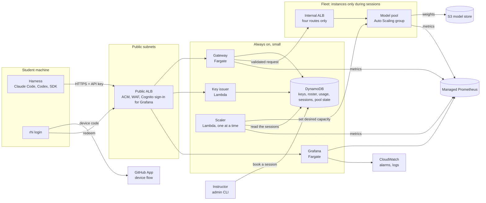
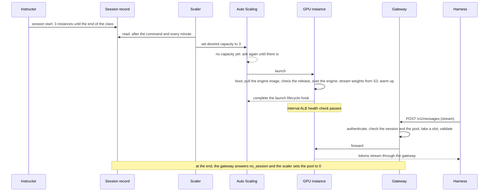
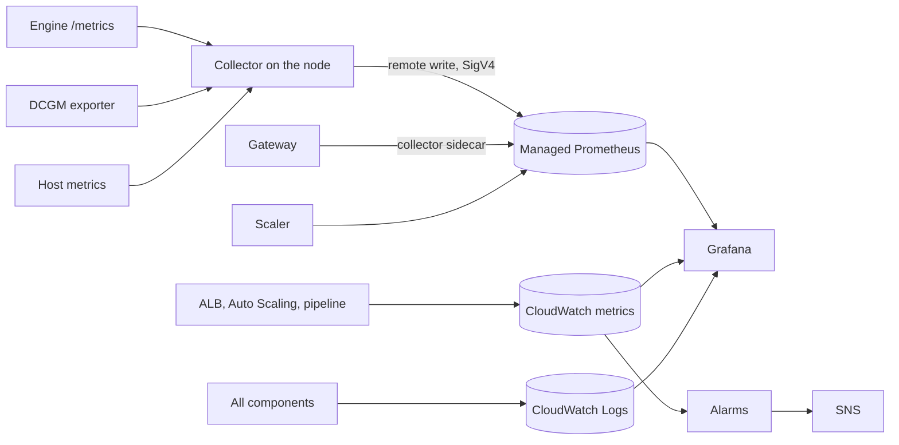

# System design: an inference endpoint for the coding-agent cursus, provisioned by session

- **Status:** Accepted ([ADR 0002](../adr/0002-accept-the-system-design.md)), amended by [ADR 0003](../adr/0003-sessions-only-and-usage-logged.md). Section 15 lists the decisions that are the owner's, settled and open.
- **Date:** 2026-11-13
- **Evidence:** a claim marked `[E n]` is traced in [`evidence.md`](evidence.md), with its source and how far it was verified. A claim marked `[S n]` is an assumption that a named validation spike must confirm (section 12).

## 0. Summary

Students of the coding-agent cursus point their harnesses (Claude Code, Codex CLI, OpenCode, Pi, their own SDK scripts, and the research skill packs that run inside them) at one HTTPS endpoint. It serves them during class sessions. The instructor books each session with one command: a number of GPU machines, from a start time to an end time. The instructor can add or remove machines, move the times and stop the session; nothing runs outside a session, and nothing scales by load. Between sessions, and whenever the endpoint is down, students use their own subscriptions to hosted models. The instructor watches everything in Grafana: the machines a session requested, those AWS has delivered, each machine's telemetry, and what each serves against what this design predicts. All of it is Python CDK, deployed only by AWS CodePipeline, in a repository that can be public.

A small always-on **gateway** authenticates each student's API key, serves it only while its pool has a session, validates the request, logs what it used and forwards it to a **pool** of GPU instances. Each pool is an EC2 Auto Scaling group with a minimum of zero, running one vLLM server per machine. One small **scaler** function is the only thing that changes a pool's size: every minute it sets each pool to what its session asks for, and to zero when it has none. AWS does not always have a GPU to give, so an instance that is asked for stays asked for until it arrives, and the instructor books ahead of the class. Metrics from every machine and from the gateway go to Amazon Managed Service for Prometheus; Grafana reads them.

Five findings shape the rest:

1. **The model is chosen for the harnesses, and it fits one GPU.** What Claude Code and Codex demand of a model (232,000 tokens of context, tool calls on nested schemas, its own reasoning accepted back, images) points to one model that fits a single GPU: Qwen3.8-27B, Apache-2.0, on one 96 GB GPU at $3.36 an hour `[E5][E28]`. Whether to serve it at 8 bits or at 4 is settled by measurement. A larger sibling on four GPUs, at $16.57 an hour, is the upgrade if one GPU per instance cannot carry a session, which phase 2 measures, and if its licence allows (section 4.2). The engine is vLLM alone: Ray Serve would add a layer that lacks two of the three routes the harnesses use (section 4.6).
2. **vLLM speaks the three wire formats the harnesses need** (Anthropic Messages, OpenAI Responses, OpenAI Chat Completions) `[E3][E15]`, so the gateway does not translate between formats. **But no open model works in Claude Code through vLLM unchanged** `[E28]`. For the chosen model, Claude Code's default request is refused and every turn recomputes the whole conversation unless two things in the request are rewritten, and a PDF ends the session unless a third is. The gateway already parses every request, because the engine's request surface is too large to hand to forty students unfiltered `[E23]`; it also carries a small per-model table of such rewrites (section 6.2).
3. **GPU capacity cannot be had at the moment it is needed, so sessions are booked ahead.** Over one day, the coursework pool's instance type had no capacity for 21 to 37 minutes on six of the nine occasions the pool asked for a machine, at every time of day, and the stopped standby instance failed to start all five times it was called `[E32]`. No client can be held that long `[E12]`, and a stopped instance holds no hardware: only a running one does. So no student's request starts a machine, and nothing scales by load. The instructor asks for a session's machines hours ahead, Auto Scaling keeps asking until AWS delivers them, and they run until the session ends. A launch itself takes an estimated 3 to 13 minutes (section 5.2).
4. **What one instance serves is an estimate until this project measures it.** With eight agents generating at once, each stream should get 15 to 22 tokens per second, which is at the edge of acceptable, and a turn whose transcript is cached should start within a second or two. One instance should carry 10 to 20 students working hands-on, and 4 to 8 when each runs several agents, as the second session's research packs do (section 4.7). Nobody has published a measurement of this model on this instance type, so those numbers are arithmetic checked against measurements on other GPUs `[E29]`. Spike `[S5]` replaces them, and the inference dashboard shows the prediction beside the measurement (section 7.2).
5. **The always-on platform costs more than the GPUs.** The course is five sessions, 12 live hours in total `[E25]`. On the coursework pool, with each session booked two hours ahead, that is about $74 of GPU time per instance for the whole course, against about $150 a month for the endpoint while it is up, which `parked` removes between uses (section 11). The cost question for the owner is the floor, not the fleet.

### Decisions at a glance

| Area | Decision | Main reason |
| --- | --- | --- |
| Model | Qwen3.8-27B at 8 bits on one 96 GB GPU; Qwen3.8-Flash-Next on four only if phase 2 shows the need, licence permitting | The only candidate that meets what the harnesses demand on one GPU |
| Engine | vLLM alone, behind an engine contract; no Ray Serve | vLLM serves the harnesses' routes itself; Ray Serve lacks two of them and pins an older vLLM |
| Compute | One EC2 Auto Scaling group per pool, min 0, no warm pool | It keeps asking for a session's instances until AWS has them; control of drivers and images |
| Scaling | One scaler function sets each pool to what its session asks; nothing scales by load | GPU capacity cannot be had at the moment a student asks `[E32]`; one writer, testable without AWS |
| Serving | Only during sessions the instructor books: a number of instances per pool, a start and an end; students use their own subscriptions otherwise | GPU time follows the class, and every session ends by itself |
| Usage and cost | Token counts logged per request, never enforced; AWS Budgets alerts; the fleet cap | The instructor decides what runs; nothing stops a class on its own |
| Routing | A student's turns stay on one instance | The engine's cache makes a turn cost a second instead of tens of seconds |
| Capacity | An instance asked for stays asked for until it arrives; a request to a pool with nothing in service is answered at once, with its cause | No hold covers a wait for capacity; the instructor books ahead |
| Gateway | Custom, on Fargate: closed route list, validated bodies, a per-model request profile, no translation between formats | Filtering is needed anyway; LiteLLM's 2026 supply-chain record |
| Student login | GitHub App device flow; the issuer redeems the code and mints a personal key | Students already have GitHub; nothing reusable is exposed |
| Edge | Public ALB, ACM certificate, own domain, WAF | No timeout cap on long generations |
| Metrics | Managed Prometheus, pushed from each node | Mature; month-long queries; nothing to discover |
| Grafana | Grafana OSS on Fargate, behind ALB sign-in with Cognito; a performance dashboard that shows the prediction | Declarative; no AWS Organizations; no exposed Grafana login |
| Delivery | CDK Pipelines (CodePipeline V2) from `main` only | Owner requirement; pull-request checks run without credentials |
| Trust | A bounded deployment role, invariants as tests, a separate identity for agents | A merge to `main` is deployment rights in the account |
| Public repo | No lookups, no literals, configuration in SSM, scanners as gates, public-safe from the first commit | Account identifiers stay out of git and out of public logs |

## 1. Context, goals, non-goals

### Requirements (from the owner)

| ID | Requirement | Where | Delivered |
| --- | --- | --- | --- |
| R1 | An inference endpoint on AWS that the students' harnesses point at | 3, 6 | Phase 1 (mock), phase 2 (GPU) |
| R2 | The instructor provisions the machines of a session: a number of instances for a given time, changed or turned off by a command. Nothing scales by load, because GPU capacity is not reliable | 5 | Phase 1 (mock), phase 2 (GPU) |
| R3 | Each machine loads an open-weight LLM, chosen for the harnesses it serves | 4.2 | Phase 2 |
| R4 | Students log in securely | 6.4 | Phase 1 |
| R5 | An admin sees all relevant telemetry in Grafana, including the GPUs a session requested and those available, each machine's telemetry, and what each pool serves against what was predicted | 7 | Phase 1, complete in phase 3 |
| R6 | Production grade; CodePipeline, Python CDK, uv, ty | 8 | Phase 0 |
| R7 | The repository can be public without leaking AWS information | 10 | Phase 0 |
| R8 | Test with a cheap model first; move to bigger models when needed | 4.2 | The coursework pool in phase 2, at $3.36 an hour, is the cheap model; the upgrade pool in phase 4 is the bigger one. Decision 2 asks the owner to accept that reading |
| R9 | Know what the chosen model and machines can serve, in tokens per second and the other numbers that matter, and measure it | 4.7, 7.2 | The estimate now; measured in phase 2 (`[S5]`) |

### Assumptions

- A1. 10 to 40 students, one instructor who is the only admin. The real number is a decision in section 15.
- A2. Five biweekly sessions, the first of four hours and the others of two: 12 live hours over about nine weeks `[E25]`. The endpoint serves only during sessions; for homework, students use their own subscriptions to hosted models.
- A3. Traffic is agentic: long streamed responses, tool calls, many sequential requests per run, minutes of silence between bursts. Every request re-sends the whole transcript, so input outweighs output about a hundred to one, and nine-tenths of it repeats the previous request `[E31]`. Section 4.7 puts numbers on this.
- A4. One AWS account, one region. The region comes from the deploying credentials, never from the repository.
- A5. The owner can register a domain name (about $15 a year).

### Non-goals

- Multi-node model replicas (one replica is one instance; the largest has 8 GPUs).
- Training or fine-tuning.
- A general multi-provider LLM gateway, or translation between wire formats.
- A second region.
- A separate staging environment (section 8.5 says what replaces it).

## 2. Architecture



| Component | AWS service | Runs when | Why this service |
| --- | --- | --- | --- |
| Edge | Application Load Balancer, ACM, Route 53, WAF | always | Idle timeout up to 4000 s `[E13]`; nothing else in the path caps a long generation |
| Gateway | ECS Fargate | always | Carries long-lived streams; Lambda and API Gateway cap or bill them badly `[E14]` |
| Key issuer | Lambda behind the ALB | on request | Separate privileges from the data path |
| Scaler | Lambda, reserved concurrency 1, run every minute and after each session command | always, cents | One writer of pool size; pure decision logic |
| State | DynamoDB on demand | always, cents | Atomic counters and conditional writes; nothing to run |
| Model pools | EC2 Auto Scaling, launch templates | during sessions | Section 4.5 |
| Pool routing | Internal Application Load Balancer | always | Health checks, draining, least-outstanding routing with stickiness per student (section 5.5), and a second route allow-list in front of the engine |
| Model store | S3 with a gateway VPC endpoint | always, cents | Cheapest at rest; streaming from S3 is within seconds of local disk `[E11]` |
| Metrics | Amazon Managed Service for Prometheus | usage-priced | Section 7 |
| Alarms, logs | CloudWatch | usage-priced | Alerts that must work when Grafana is down |
| Dashboards | Grafana OSS on Fargate; Cognito for sign-in | always | Section 7.4 |
| Delivery | CodePipeline V2, CodeBuild, CodeConnections, ECR | on merge | Owner requirement R6 |
| Guardrails | The fleet cap, the end of every session, AWS Budgets alerts, CloudWatch alarms, SNS | always, cents | Section 11.3 |

## 3. Request flow

**During a session.** The harness sends a request with its API key. The public ALB terminates TLS. The gateway hashes the key, finds the student, checks that the pool has a session and an instance in service (section 5.6), takes a concurrency slot, validates and rewrites the request body, and sends it to the internal ALB. The ALB sends it to the instance that served that student's previous turn, or, for a student it has not seen, to the instance with the fewest requests in flight (section 5.5). The response streams back through the gateway, which reads token usage from it as it passes, logs it and releases the slot.

**Before it.** The instructor books the session, and the request path has no part in starting a machine:



A request that arrives while its pool has no session, or before any of the session's instances is in service, is answered at once with a proper error for that wire format, naming one of a fixed set of causes (section 5.3).

## 4. The inference fleet

### 4.1 Engine contract

A model server is anything that satisfies this contract. The gateway, the scaler, the dashboards and the tests depend on the contract only.

| Capability | Contract |
| --- | --- |
| Inference | `POST /v1/chat/completions`, `POST /v1/responses`, `POST /v1/messages`, `POST /v1/messages/count_tokens`, with SSE streaming and tool calling |
| Health | `GET /health` returns 200 only when the model can serve |
| Metrics | `GET /metrics` in Prometheus format, on localhost only. At least: running and waiting requests; time to first token; time per output token; input tokens, the cached part of them, and output tokens; cache use |
| Reachability | Port 8000 accepts connections from the internal ALB only. The internal ALB forwards the four inference routes and answers 404 to everything else. Those routes require the pool's bearer secret |
| Identity | The instance's lifecycle agent reports the image digest and model revision being served, in its heartbeat and as a metric. The engine itself does not know its image digest |
| Shutdown | Finishes in-flight requests on SIGTERM |

The reachability row is worded carefully because the engine cannot be trusted to protect itself: vLLM's `--api-key` covers only some path prefixes, and routes such as `/invocations` and `/pause` answer without it `[E23]`. The allow-list on the internal ALB is the control; the secret is a second lock. The pipeline's verification calls the forbidden routes through the gateway and expects 404. The internal ALB's own rules, the four inference routes forwarded and a 404 for everything else, the health route included, are asserted on the synthesized template: only the gateway can reach that ALB (section 6.5), so a test run from outside the private network cannot call it, and opening the network to one would weaken the rule it tests.

The contract suite (`tests/contract/`) runs against the mock in CI, and against a deployed engine on that engine's own node, at `http://127.0.0.1:8000`: the engine shares the host's network. The Systems Manager document `rhi-engine-contract`, of type Command and with no parameter, runs the release's script on an instance (section 4.3), and nothing else, so whoever may send it can run the check and no other command. The script reads the pool's secret as the engine's unit does, hands it to the suite's container on its standard input only, and runs the four tests an engine at an address answers (inference, health, metrics, the bearer secret). Run Command keeps the output in the account, so the script prints a fixed vocabulary only: one line `rhi-contract <test> <outcome>` per test and a last line `rhi-contract exit <status>`, nothing of pytest's report, of the engine's answers or of AWS's text. The suite does not run through the internal load balancer. Two of its rows cannot pass there by design: the load balancer answers 404 to the health route and to `/metrics`, and the engine serves `/metrics` on localhost only. And the network rule of section 6.5 would have to give way: opening the load balancer's group to a test job would weaken the rule it tests, and a job in the VPC that reached an instance's port 8000 directly would break its second half and be one more reader of the pool's secret. Run Command reaches the instance's agent through `ssmmessages`, the channel of Session Manager, whose actions the instance role already holds.

Engine adapters:

| Adapter | State | Notes |
| --- | --- | --- |
| `mock` | Phase 1 | A CPU container that satisfies the contract with canned streams. It makes the whole control loop testable for cents, in CI and in the deployed stack |
| `vllm` | Phase 2 | Serves all inference routes natively, plus `/health` and `/metrics` `[E3]`. The only GPU engine this design plans (section 4.6) |
| `sglang` | Not planned | The candidate if vLLM disappoints on a model; different metric names `[E19]` |

Engines name their metrics differently. First-party dashboards build their queries from a small per-engine table, so adding an engine is one adapter and one table row. The table names the same quantities for every engine: the ones section 4.7 predicts and section 7.2 measures.

Engine settings that are part of the contract for vLLM: usage telemetry off, Hugging Face access off, no request-supplied chat templates, no development or profiling routes, media fetching restricted to inline data `[E23]`. A test of the unit file asserts them.

### 4.2 The model, and the pools that serve it

A **pool** is one model on one family of instance types. It is declared in configuration and becomes one Auto Scaling group, one target group and one dashboard row.

```toml
[pools.coursework]
engine = "vllm"
model = "Qwen/Qwen3.8-27B-FP8"
revision = "<pinned commit of the model repository>"
instance_types = ["g7e.2xlarge"]       # one 96 GB RTX PRO 6000, 4 cores; fallback types may follow
max_instances = 2                      # the most a session may ask of the pool
target_concurrency = 8                 # requests an engine runs at once
drain_seconds = 300                    # what a request has to finish when its instance leaves
```

`max_instances` is the cap on what a session may ask of the pool, and the group's maximum size. Nothing in a pool's entry starts a machine: a session does (section 5.6).

Students choose a pool by model name. Moving to another model is a new pool entry and a merge.

**What the harnesses ask of a model.** The model is chosen for the programs that will call it: Claude Code as the anchor, Codex beside it, their headless and SDK forms, and the research skill packs of the course's second session, which run inside them `[E25]`. Those programs make demands that most open-weight models, or vLLM's support for them, do not meet today `[E28]`:

| The model must | Because |
| --- | --- |
| Serve at least 232,000 tokens of context | Behind the gateway Claude Code sends its own `claude-` names, which it recognises, and works with the 1M window of those of its models that have one, so by default it would compact a session only near 967,000 tokens `[E15]`. `rhi login` therefore sets Claude Code's auto-compact window to 200,000 tokens (section 6.4, step 5), and Claude Code asks for up to 32,000 tokens of output on top of it. When a prompt is too long, the gateway answers vLLM's refusal with the cause `context_length_exceeded` (section 6.2, step 8), a 400 whose message begins with Anthropic's own words for it, on which Claude Code compacts the session and sends the turn again |
| Call tools through a parser that vLLM ships, on nested schemas | vLLM turns a model's tool calls into the wire format with one parser per model family `[E4]`. Claude Code sends about 25 tools with deeply nested schemas on every request; Codex sends its own on the Responses route |
| Accept its own reasoning back in the history | Claude Code returns earlier reasoning blocks with each request. A model whose template rejects them fails, and one whose template drops them loses its thread in the middle of a tool loop |
| Read images | Claude Code reads screenshots and plots; the paper-writing pack's drafting agent reads the figures it writes about |
| Do agent work well, measured inside a harness | The coursework is optimisation modelling in Python, running solvers and writing LaTeX: long tool loops, not chat |
| Leave room on its GPU for a class | Every request keeps its whole transcript in GPU memory while it runs. What a token costs there varies eightfold between the candidates (section 4.7) |
| Carry a licence without conditions, and need no code from its repository | A public course; model code is off by default (section 4.4) |
| Have a vLLM recipe run on the instance's GPU | Otherwise this project is the first to try the combination. In these recipes "verified" means the model started, served and answered a prompt on that GPU, no more |

The research packs add three things that are about vLLM more than about the model `[E28]`. None of them changes which model is chosen; each is a limit to handle and to tell students about:

| The pack does | Behind vLLM | What this design does |
| --- | --- | --- |
| Runs several agents at once | Each is a stream on the GPU | Counted in the capacity of section 4.7 |
| Reads PDFs | Claude Code sends a PDF as a document block. vLLM refuses it, and every later request of that session then fails | The request profile replaces such a block with a line of text saying the endpoint cannot read it (section 6.2). The student guide says to convert a PDF to text first, which the agent can do itself |
| Loads skills and adds tools in mid-session | Claude Code carries them in system messages placed mid-conversation. vLLM 0.33 accepts the blocks; the request profile changes those messages' role | Spike `[S3]` checks that a skill loaded mid-session still works |
| Searches the web | Claude Code's built-in search is expected not to work here: it is run by its vendor's service, not by the harness. Not verified | The course's science skills search through public services from the student's machine `[E25]`. `[S3]` confirms, and the guide says so |

The candidates that fit one GPU, and the two larger ones, worth a session that one GPU per instance cannot carry. Six more were considered and are listed with their reasons in `[E28]`:

| Model | Size | Licence | Context | Images | Evidence on agent work | Verdict |
| --- | --- | --- | --- | --- | --- | --- |
| **Qwen3.8-27B** | 27.8B, dense; 31 GB at 8 bits, 22 GB at 4 | Apache-2.0 | 262,144 | Yes | Its publisher ran SWE-bench Pro inside Claude Code: 61.7. An independent index puts it above the one other single-GPU candidate that has a score. No independent agent benchmark yet | **The coursework model** |
| Qwen3.6-27B | 27.8B, dense | Apache-2.0 | 262,144 | Yes | The only candidate with an independent agent result: 31.2% on SWE-rebench. Its publisher scores it 53.5 where the 3.8 scores 61.7. Loses its reasoning mid-loop in Claude Code | The fallback if the 3.8 fails `[S3]` for a reason of its own. Same size and speed |
| Qwen3.6-35B-A3B | 36B, 3B active per token | Apache-2.0 | 262,144 | Yes | Independent: 24.7% on SWE-rebench, below the dense model of its generation. Same loss of reasoning. Needs model code | About three times faster per stream, weaker at the work. The fallback if speed proves the constraint |
| gpt-oss-120b | 117B, 5B active | Apache-2.0 | 131,072 | No | The example in vLLM's own guide for Claude Code. Drops images and flattens Claude Code's tool schemas | Fails on context and on images |
| **Qwen3.8-Flash-Next** | 176B, 6B active; 186 GB at 8 bits | Qwen community licence | 262,144 | Yes | Publisher, in Claude Code: 62.5 on SWE-bench Pro, and 58.7 against the 27B's 42.2 on a second set | **The upgrade model** |
| DeepSeek-V4.1-Flash | 763B by its repository's count, 16B active; 510 GB | MIT | 1M | Yes | Highest independent index of the models that fit one machine. Rejects one of Claude Code's effort values | The optional xl model |

**The coursework model is Qwen3.8-27B.** It is the only candidate that meets every row of the first table on one GPU. Its architecture is also cheap per token of transcript: only 16 of its 64 layers keep a per-token cache, which comes to about 40% of what the conventional models of its size cost `[E28]`. That is what lets one GPU hold a class's sessions. Four things about it are less solid than the table makes them look, and section 12 tests each:

- **Its quality rests on its publisher's numbers.** The independent evidence is one composite index and the previous generation's result on SWE-rebench. Spike `[S3]` runs the course's own kind of task in each harness, which is worth more here than any leaderboard.
- **It does not work in Claude Code through vLLM unchanged.** No open model does: the vLLM project replayed real Claude Code traffic through its Messages route and found a defect for every model family `[E28]`. For Qwen3.8 two of them matter, and the gateway handles both (section 6.2).
- **Which build to serve is open.** The publisher's 8-bit build is the default here, because it is the publisher's own and the less compressed. But it is not one of the two builds the recipe ran on the G7e GPU: those were the 16-bit weights and a 4-bit build published by NVIDIA. The recipe ran the 8-bit build on an RTX 5090, a GPU of the same generation. By the arithmetic of section 4.7 the 4-bit build is also about 40% faster. What nobody has measured is what 4 bits cost in the accuracy of tool calls. `[S3]` and `[S5]` run both builds, and the 4-bit build becomes the default if it does the tasks as well. The 16-bit weights are not a fallback: at that size the GPU would serve each stream below the floor of section 7.3.
- **It reasons before it answers.** Every turn starts with reasoning, at an effort the request sets. How long a turn takes depends on that setting more than on anything else in this design (section 4.7).

The pools:

| Pool | Model | Weights | Engine and instance | $/hour | What is known |
| --- | --- | --- | --- | --- | --- |
| mock | canned responses | none | `mock` on `t4g.small` | 0.02 | Phase 1 |
| coursework | Qwen3.8-27B, 8-bit | 31 GB | vLLM 0.33 or later on `g7e.2xlarge`, one 96 GB GPU | 3.36 | The default pool, and the first GPU pool built. Section 4.7 estimates what it serves |
| upgrade | Qwen3.8-Flash-Next, 8-bit | 186 GB | vLLM on `g7e.24xlarge`, 4 × 96 GB | 16.57 | Recipe run on four of this GPU. Same chat template and parsers as the coursework model, so the same request profile. Its licence may not allow this use without its publisher's agreement: decision 3 (section 15) |
| xl | DeepSeek-V4.1-Flash | 510 GB | vLLM on `p5en.48xlarge`, 8 × H200 | 63.30 | Optional, built only if the owner asks. The one pool with a published benchmark on agent traffic (section 4.7). Long first load `[E2]` |

Engine settings that belong to the coursework pool's release. They are the ones the recipe used on this GPU with the 4-bit build `[E28]`: the full 262,144-token context; an 8-bit cache; prefix caching; at most 8 requests running at once, which is also the pool's `target_concurrency`; a budget of 8,192 tokens for each engine step, which trades steadier streams against a faster first token (section 4.7); the `qwen3_coder` tool parser and the `qwen3` reasoning parser. To these the design adds a served name without a slash, which Claude Code requires, and finer histogram buckets and cache metrics than vLLM's defaults (section 7.2).

What the owner should take from this:

- **There is no cheaper GPU tier below the coursework pool.** A smaller model would run a different chat template and different parsers, so it would exercise none of the request handling the coursework model needs. The same model on a 48 GB GPU, at 4 bits, has been run by a third party and holds two to four sessions `[E29]`; it would be a second configuration to keep working, to save $1.12 an hour. The mock proves the control loop for cents, and the first GPU pool is the one the class uses. R8 asked for a cheap model first: the coursework model is the cheap one, and decision 2 asks the owner to accept that reading.
- **The upgrade pool is built only if the coursework pool cannot carry a session.** Spike `[S5]` measures that in phase 2, and the pool waits for its numbers. If it is built, the instructor books it like any other pool, and earlier, since its weights take minutes to load (section 5.2). One upgrade instance should carry a class that needs several coursework instances, and serve each student faster, by a margin nobody has measured (section 4.7).
- **The model is a configuration entry.** A model that meets the first table better replaces this one with a merge and a pass of `[S3]`. Qwen has announced a next generation with no weights yet `[E28]`.

### 4.3 What happens on an instance

The launch template names an AWS-published GPU machine image by ID, read from an SSM parameter in the owner's account. A promotion job changes that parameter only after a canary start on the new image passes, so an unrelated merge can never change the driver under a pinned engine. That canary start is the one GPU instance that runs outside a session (section 11.3): the owner starts the job, which launches one instance from the pool's launch template, outside the group, and terminates it. The image must list the pool's instance family, and the promotion job refuses a pool whose family it does not list. The image is AWS's base GPU image with the open-source NVIDIA driver on Ubuntu 22.04. Its release of 10 November 2026 lists G6e, G7e, P5 and P5en `[E10]`.

User data holds no settings and installs one thing: a small boot unit. When the instance starts, that unit reads the pool's current release (engine image digest, model revision, engine flags) from one parameter, fetches that release's unit files and lifecycle agent from the pipeline's artifact bucket, checks them against the digest recorded in the same parameter, and starts them. An instance therefore starts on the release deployed at that moment, whatever its launch template was written with. Docker's data and the engine's compile cache live on the EBS volume. Four systemd units run:

1. `rhi-engine`: the engine container with the NVIDIA runtime. Weights load straight from S3 into GPU memory. Its bearer secret comes from Secrets Manager at start, never from user data.
2. `rhi-dcgm`: the NVIDIA DCGM exporter, bound to localhost.
3. `rhi-collector`: an OpenTelemetry collector that scrapes the engine, DCGM and host metrics on localhost and pushes them to Managed Prometheus.
4. `rhi-lifecycle`: a small agent with five duties. On launch, it abandons the instance unless what is on disk equals the pool's current release; it completes the launch hook only after the engine answers a real warm-up request. While serving, it writes a heartbeat row every 5 seconds with the engine's running and waiting counts and the release it serves, and it runs a one-token completion every minute, because an engine can hang with its health route still answering `[E23]`. A completion that fails restarts the engine only when the engine has counted no token for a minute: when no heartbeat of the 60 seconds before the failure read a sum of the engine's input and output token counters (section 4.1) greater than the heartbeat before it. The reason is that a busy engine can take longer than the completion's limit, 30 seconds, to answer it: under long contexts with requests queued, the completion waits its turn, and a restart then kills every request in flight and empties the prefix cache, which makes the next completion slower still. The health route and the running and waiting counts cannot tell a busy engine from a hung one, which goes on reporting the requests it holds; what a hung or dead engine cannot do is compute or generate a token. A metrics route that does not answer shows no progress. The window is the minute between two completions, not the completion's limit, because an engine may count a request's input tokens only once its prefill ends; a hung engine is restarted at most about a minute later for it. On termination, it completes the hook once the engine reports nothing running or waiting.

The lifecycle transitions are specified, not left to defaults `[E10]`:

| Transition | What the agent does | Timeout, and what follows |
| --- | --- | --- |
| An instance launches | Pull the image, check the release, start the engine, warm up, complete the hook | 15 minutes on the coursework pool until a launch has been measured, then twice the measured launch; heartbeats extend it for the multi-GPU pools. Then the instance is abandoned, and the group launches another |
| An instance leaves service | Wait for the engine to drain, complete the hook | `drain_seconds` plus a margin. Then the instance leaves |

Without explicit timeouts a hook waits an hour, and a dead agent bills an hour of GPU per attempt.

Zone rebalancing is suspended on GPU groups, because it replaces instances in service. New instances are protected from scale-in; the scaler lifts that protection when it chooses which instance leaves (section 5.1).

Instances have no public IP and no SSH. IMDSv2 is required. Debugging is through Session Manager with a custom minimal policy; the AWS-managed policy would let every instance read all SSM parameters, including this project's configuration `[E23]`. The instance role can read its model prefix in S3, read its pool's secret, write metrics and logs, pull its image, and complete lifecycle actions for its own group.

The release's archive carries the engine contract suite beside the lifecycle agent: a folder `contract/` holds the suite as the repository has it, the three packages its modules import (`rhi_common`, `rhi_gateway`, `rhi_mock_engine`), the libraries of the `contract` dependency group at their locked versions, pure Python as the agent's are, and the script that runs it. The boot unit unpacks it with the rest of the archive, after checking its digest, so every instance holds the suite of its own release with nothing downloaded on the node. The document `rhi-engine-contract` runs that script (section 4.1), in the Python image of the agent's unit, read-only, with the host's network.

The engine image is a thin layer over the upstream vLLM image pinned by digest, built by the pipeline into ECR. **A deployment replaces no instance, and needs none replaced.** A pool has no instance outside a session, and a deployment waits while a session is active (section 8.2), so a release normally finds nothing to reach: the next session's instances launch from the new launch template and read the new release at their start. An instance that is in service when a release changes, because a session was booked while a deployment was under way, keeps what it started with until it leaves, and its heartbeat says which release it serves (section 4.1). There is no instance refresh: it would replace the instances of a session, and give back GPUs that may take long to get again (section 5.4). After a deployment that changes a GPU pool's engine image, model revision or engine flags, the pipeline's verification books an instance and asserts that it serves the release deployed (section 8.2).

### 4.4 Model weights

- A pipeline job copies each pool's model, at its pinned revision, from Hugging Face into the model bucket. It copies only an allow-list of file types (safetensors, JSON, tokenizer files) and refuses pickle formats and Python files. It verifies every file against a SHA-256 manifest committed to the repository. Only that job's role can write to the bucket.
- Model code from a repository (`trust-remote-code`) is off by default. The coursework and upgrade models do not need it `[E28]`. A pool that does is a reviewed exception recorded with that pool; the DeepSeek V4 recipes ask for it `[E2]`.
- Instances read weights through the S3 gateway endpoint and never talk to Hugging Face.
- vLLM's Run:ai streamer loads from `s3://` into GPU memory. AWS measured 15 GB in about 5 seconds and 200 GB in about 25 seconds when tuned; defaults can be ten times slower, and one model was reported slower than the plain loader `[E11]`. The loader is a per-pool setting, with "download to local disk, then load" as the fallback `[S4]`.
- At rest, S3 costs $0.023 per GB-month: under $1 for the coursework model, about $4 for the upgrade model, about $12 for the 510 GB one.

### 4.5 Why plain Auto Scaling groups

| Option | What decides | Verdict |
| --- | --- | --- |
| **EC2 Auto Scaling group** | It keeps asking for the instances a session wants until AWS has them, in every zone and for every instance type the pool lists, with no code of ours `[E32]`. Lifecycle hooks keep an instance out of service until its model answers, and let it drain on its way out. The machine image and the driver are ours to choose. Est. 3 to 13 min from launch to serving `[S1]` | **Chosen** |
| The same group with a stopped warm pool | Est. 2 to 6 min to serving when the stopped instance starts. A stopped instance holds no hardware: it can start only in its own zone and as its own type, fails when that has no capacity, and is then terminated and replaced by a new launch `[E10][E32]`. In the account, 5 starts of 5 failed that way `[E32]`. It also costs its disk, two more lifecycle transitions and an instance refresh on every release | It narrows the search for capacity when capacity is the constraint, to save minutes that nobody waits for once sessions are booked ahead |
| ECS Managed Instances | No choice of machine image `[E9]`. AWS measured 13 min from request to first output with a 14 GB image | Simplest to operate, without control of the driver under a pinned engine |
| ECS on EC2, capacity provider | Managed scaling decides the size itself, and starts **two** instances from zero `[E9]` | A second writer of pool size |
| SageMaker real-time | Streams capped at 8 minutes; one invocation contract against three routes; 15 to 40% dearer `[E8]` | Still needs this gateway; less control for more money |
| EKS Auto Mode + KEDA | $73 a month of control plane and Kubernetes operations for one person `[E9]` | Too much to operate |
| Bedrock Custom Model Import | No CloudFormation support, no Prometheus metrics, and the machines are not ours (R2, R3) `[E22]` | Not this project |

What decides is the wait for capacity, not the length of a start: a group asks again by itself until an instance arrives, wherever the pool allows one, and nothing in the path caps a long agent turn. One model server per instance needs no container scheduler.

The price is real and larger than four systemd units: this project owns the boot sequence, the lifecycle hooks, draining and the image promotion.

### 4.6 Why vLLM alone, without Ray Serve

Ray Serve is not another engine. Its LLM module starts vLLM inside a Ray cluster and puts a router, replica autoscaling and multi-model serving around it. The question is whether this design needs that layer between the gateway and vLLM. It does not, and adding it would take away things the design depends on `[E30]`.

| What Ray Serve offers | What this design has for it | Verdict |
| --- | --- | --- |
| An OpenAI-compatible front door | vLLM's own routes for Messages, Responses and Chat Completions (section 6.1) | Ray Serve's stable front door serves Chat Completions but neither Messages nor Responses, as of Ray 2.60. The pull requests that added them there were closed unmerged. Claude Code and Codex could not connect; the workaround is an experimental mode that exposes vLLM's own application for one model. Ray is working on that mode: support for Messages in its cache-aware router was merged in October 2026 and is not yet released |
| Replica autoscaling and scale to zero | The scaler, the only writer of pool size, which sets each pool to what its session asks (section 5.1) | Ray would be a second writer of fleet size, and would decide by load what this design leaves to the instructor |
| Starting and stopping machines | Auto Scaling groups (section 4.5) | Ray's launcher for EC2 creates instances itself, outside CloudFormation and outside the groups, and needs a head node that is always on and is a single point of failure |
| Several models on shared GPUs, adapters swapped per request, one model across several nodes, pipelines of models | Nothing: one model per instance, and nothing spans nodes (section 1, non-goals) | No use here |
| Routing that follows the engine's prefix cache | Affinity by student (section 5.5), which this comparison prompted | Ray's router follows the cache more finely, and ignores the per-student salt this design uses `[E30]`. With pools of one to four instances, affinity by student captures the reuse there is |
| Its own dashboard and metrics | Prometheus and Grafana (section 7) | A duplicate |

Three costs weigh beyond the table:

- **Ray pins the vLLM version.** Ray 2.60.0 requires vLLM 0.29.0, four minor releases and eight weeks behind upstream on the day it shipped `[E30]`. vLLM releases are how this design gets security fixes (sections 4.3 and 9) and support for a new model, and vLLM ships one about every two weeks `[E3]`.
- **Ray assumes a trusted cluster.** Its documentation says any client that can reach a cluster can run code on it. This design treats the engine as its least trusted component (section 4.1): a compromised engine holds its own instance's role and sees the requests sent to it. Inside a Ray cluster it could reach every node and the head.
- **More to operate.** A head node, a larger image, a second control loop and a second set of metrics, for one operator and pools of one to four instances.

The answer changes if Ray ships stable routes for Messages and Responses with a vLLM within a release or two of upstream, which is the direction it is moving in; if a model must span several nodes; if many small models must share few GPUs; if a pool regularly runs more instances than the rebalancing of section 5.5 keeps even; or if the platform moves to Kubernetes. Offline batch work, which the research skill packs could use, would be a case for Ray Data, which does not need Ray Serve.

### 4.7 What a pool can serve

R9 asks what the chosen model and machines can deliver, in tokens per second and in the other numbers that matter. This section gives estimates, says what each rests on, and uses the quantities that section 7.2 measures in Grafana, so that prediction and measurement sit on the same panel.

**No number for the coursework pool below is a measurement on its instance type: nobody has published one.** They are arithmetic from the GPU's memory bandwidth and the model's shape, checked against published measurements of the same model on other GPUs `[E29]`. Spike `[S5]` replaces them with measurements.

**The quantities.**

| Quantity | What it is | What it decides |
| --- | --- | --- |
| Time to first token | Seconds from a request reaching the engine to its first token: queueing, then *prefill*, which is computing the part of the transcript the engine has not cached | How long a student waits before anything moves |
| Output speed per stream | Tokens per second that one request receives while it generates | How long a reply takes: 500 tokens at 20 per second is 25 seconds |
| Output throughput | Tokens per second from all the streams of an instance, or of a pool | Cost per token |
| Prefill speed | Input tokens computed per second | Time to first token when the cache misses, and how much each new turn slows the streams beside it |
| Cached share of input | The fraction of input tokens the engine did not have to compute | Whether a turn starts in a second or in tens of seconds |
| Cache capacity | Tokens of transcript one GPU holds, for running requests and for recent ones | How many sessions fit before the engine queues, preempts, or forgets an idle session |
| Concurrent streams | Requests generating at once on an instance | How many instances a session needs |
| Cost per million tokens | An instance's hourly price over what it produced | Comparison with a hosted model |

"Tokens per second" alone is ambiguous: per stream it says what a student sees, summed it says what a machine yields. This design always says which.

**The load.** Public replays of real Claude Code sessions show what an agent sends `[E31]`. A request carries a median of 74,000 to 130,000 input tokens, and a tenth carry over 230,000. It returns a median of 300 to 500 tokens, with a mean near 1,000. Between 91 and 98% of the input repeats the previous request. A running session sends a request every 12 to 25 seconds. Those sessions come from heavy users of fast hosted models, so three assumptions stand between them and this class, and `[S5]` tests each:

- **Transcripts of 50,000 to 100,000 tokens.** Nothing enforces this. Claude Code compacts a session near its window, which is 200,000 tokens here, so the table has a row for 150,000.
- **Turns that add 1,000 to 5,000 input tokens and produce about 500.** The 500 comes from other models. This one reasons before it answers, and how much depends on the effort the request sets (section 6.2).
- **A running agent holds a stream about 80% of its time.** A turn of 500 tokens takes 23 to 33 seconds to generate at the speeds below, and the tools between turns are assumed to take 5 to 10.

**The coursework pool, per instance**: Qwen3.8-27B at 8 bits on one 96 GB GPU, with an 8-bit cache. A stream's speed is bounded by memory traffic: each step of the engine reads the weights once, and the cached transcript of every stream. The estimates take 77 to 87% of that bound, which is the range the measurements of `[E29]` support.

| Quantity | Estimate | Rests on |
| --- | --- | --- |
| Output speed, one stream alone | 40 to 45 tokens/s; 35 to 40 with a 100,000-token transcript | 31 GB of weights read for each token, at 1,597 GB a second: a bound of 52. The same model at 4 bits on a 48 GB GPU was measured at 43.7 tokens/s, 80% of that GPU's bound or more |
| Output speed per stream, 8 streams, decode alone | 20 to 30 tokens/s | The bound with eight transcripts of 50,000 to 100,000 tokens read at each step. An upper limit: it leaves out the next two effects |
| Output speed per stream, 8 agent streams | **15 to 22 tokens/s** | The row above, less the time the GPU spends computing the streams' new input (about a sixth, from the load above), less a cost per extra stream that the same model shows on the 48 GB GPU (18% at four streams) |
| The same, with transcripts of 150,000 tokens | 12 to 14 tokens/s | The same arithmetic |
| Output throughput, 8 agent streams | 120 to 180 tokens/s | Eight times the per-stream figure |
| Prefill speed | 4,000 to 6,000 input tokens/s on a long transcript; up to about 10,000 on short prompts | Long: the rate this GPU reaches on a smaller model, scaled by the two models' sizes, and the 1,100 tokens/s or so that a report on an NVIDIA GB10 desktop implies for this model. Short: the same model on the 48 GB GPU computed 15,000 tokens in 3 seconds |
| Time to first token, a turn whose transcript is cached | 0.3 to 1.5 s on the GPU | 1,000 to 5,000 new tokens at the prefill speed. Before that the server renders and tokenises the whole transcript on the instance's four cores, which is not estimated here |
| Time to first token, the first turn of a session | 2 to 5 s | Claude Code's opening of about 20,000 tokens, computed once for each student because the cache salt is per student |
| The same, twenty students starting in the same minute | 30 to 50 s for the last of them on two instances; 70 to 100 s on one | 400,000 tokens of openings, computed eight at a time. Every stream already running slows meanwhile |
| Time to first token, transcript not in the cache | 10 to 25 s | 50,000 to 100,000 tokens at the prefill speed. This is what sections 5.5 and 6.2 exist to prevent |
| Cache capacity | 1.1 to 1.8 million tokens; half that with a 16-bit cache | 51 to 54 GiB left after the weights, at 32 to 48 KiB a token: the model's shape gives 32, and a published run on a smaller GPU puts it under 48 and shows the 8-bit cache holding exactly twice the 16-bit one |
| Sessions held in the cache | 11 to 36; 7 to 12 at 150,000 tokens each | The capacity over the size of a transcript |
| Students per instance, working hands-on | 10 to 20 | Eight streams carry about ten running agents. Between half and all of the students have one running at a given moment |
| Students per instance, each running several agents | 4 to 8 | The second session's packs run plotting and literature agents in parallel and draft in one long pass: one or two streams a student, almost all the time |
| Cost per million output tokens | $5.20 to $7.80 with eight agent streams | $3.36 an hour over 120 to 180 tokens/s. An idle instance costs the same per hour |

Three of these rows carry the design.

- **The cached share.** A report on vLLM's tracker replayed a real Claude Code session of 52,000 to 65,000 tokens on this model, on a small desktop machine: the time to first token fell from 30 to 43 seconds a turn to 2 to 6 once the conversation stayed in the cache `[E29]`.
- **Speed per stream.** At 15 to 22 tokens a second, a reply of 500 tokens takes 23 to 33 seconds, and the estimate sits on the floor that section 7.3 sets for an acceptable class. `[S5]` may well show the pool below that floor at eight streams. The levers below are the answer, in order. If they are not enough, the pool runs fewer streams on each instance, which means more instances for the same class.
- **Students per instance.** It halves when students run several agents each. A class of twenty that fits two instances in the first session needs three to five in the second, or the upgrade pool.

**Levers, in the order to try them.** Spike `[S5]` measures each.

- **The 4-bit build.** It reads 22 GB for each token where the 8-bit build reads 31, so by the same arithmetic it gives 18 to 28 tokens per second at eight agent streams, and it leaves 8 GiB more for the cache. It is one of the two builds the recipe ran on this GPU (section 4.2). The price is unknown: what 4 bits do to tool calls.
- **Reasoning effort.** The request profile maps Claude Code's default to the model's highest setting (section 6.2). Mapping it one step lower shortens every turn. The cost is quality, which `[S3]` judges.
- **A smaller window.** Claude Code compacts a session when it nears its auto-compact window, and a setting, `CLAUDE_CODE_AUTO_COMPACT_WINDOW`, sets that point `[E15]`. Behind the gateway Claude Code works with the 1M window of its own models, so `rhi login` already writes the setting, at 200,000 tokens, to stay inside the served context (section 4.2). The lever is a lower value: at 100,000 tokens instead of 200,000, streams stay in the faster rows of the table and more sessions fit the cache; each compaction costs the student some context and one full prefill.
- **The 8-bit cache**, assumed above. It halves what a token of transcript costs. If it harms answers, the 16-bit cache halves the sessions an instance holds and slows every step.
- **The model's own draft head.** The checkpoint includes a head that proposes several tokens at once. On the 48 GB GPU it raised speed by half at one to four streams `[E29]`. vLLM has an open defect with longer drafts on this model, so it is off until `[S5]` shows it helps and `[S3]` shows it changes no tool call.
- **The step budget.** A smaller budget of tokens for each engine step keeps streams steadier while a long transcript is computed, and makes that transcript's first token later `[E29]`.
- **A shared cache salt for class sessions.** With one salt for the class, students would share whatever part of the 20,000-token opening is identical, and a class starting together would not queue behind its own openings. It would also let one student test whether another has sent a given text (section 6.6). The default stays per student.
- **A larger instance of the same family**, if the four cores prove the limit on the time to first token.
- **More instances.** An instance adds streams, not speed: each student still gets what one GPU gives one stream.
- **The faster sibling.** Qwen3.6-35B-A3B should generate about three times faster per stream, going by a measurement of a model of its shape on this GPU `[E29]`, and is weaker at agent work (section 4.2).

**The larger pools.**

| | upgrade: Qwen3.8-Flash-Next on 4 × 96 GB | xl: DeepSeek-V4.1-Flash on 8 × H200 |
| --- | --- | --- |
| What the numbers are | Judgment, from measurements of two other models with 5 and 10 billion active parameters on this GPU `[E29]`. The weakest numbers of this section: nobody has published a measurement of this model, or of any model on four of these GPUs | A third party's benchmark that replays Claude Code sessions on this class of machine, with vLLM 0.33, 4-bit weights and the model's draft head on `[E29]` |
| Output speed per stream | 60 to 100 tokens/s alone; 40 to 60 at 8 streams; 25 to 40 at 32 | 376 alone; 296 at 8; 215 at 16; 143 at 32; 60 at 64 |
| Output throughput | 800 to 1,300 tokens/s at 32 streams | 1,239 tokens/s at 32 streams; 2,227 at 64 |
| Time to first token, cached turn | Under 1 s | 0.24 to 0.36 s at the median, up to 64 streams |
| Cache capacity | Several million tokens | Not published |
| Students per instance | A class of twenty; forty if they work hands-on | Forty in any session |
| Cost per million output tokens | $3.50 to $5.80 at 32 streams | $14.20 at 32 streams; $7.90 at 64 |

**What it means for a class.**

| Class | Working hands-on | Each student running several agents, as in the second session |
| --- | --- | --- |
| Twenty students | 1 to 2 coursework instances: $3.36 to $6.72 an hour | 3 to 5 coursework instances, $10 to $17 an hour, or one upgrade instance at $16.57 |
| Forty students | 2 to 4 coursework instances: $6.72 to $13.44 an hour. Or one upgrade instance | 5 to 10 coursework instances, or the upgrade pool beyond what its estimate covers. The xl pool is the one sized for this |

A session's number of instances is therefore the instructor's to set when booking it (section 5.6), from this table and from what the dashboard showed of the session before: nothing adds an instance by load. `max_instances` caps what a session may ask, and the GPU quota must cover one instance more (section 5.4). A deployment waits while a session is active (section 8.2), so the maximum cannot be raised during one: it is set generously, to what the quota allows, and the instructor books what each session needs under it. The example configuration's two instances fit a class of twenty working hands-on.

**How the estimate is checked.** Spike `[S5]` measures every row of the coursework table with replayed agent sessions of both shapes, hands-on and several agents a student, at 1, 4, 8 and 16 streams and at the class's size, for the 8-bit and the 4-bit build. It records the result under `docs/measurements/`; that record replaces this table. Each pool's configuration carries its expected values for speed per stream, time to first token and cache capacity. The inference dashboard shows them beside the live series (section 7.2), and the dry-run class of phase 3 is judged against them.

## 5. Scaling

### 5.1 One writer: the scaler

If the admin's commands, CloudWatch alarms and scheduled actions could each change a pool's size, they would race: a read-then-write on desired capacity, a stop undone by the next alarm. So one function decides, and only it writes.

The **scaler** is a Lambda that runs one invocation at a time: every minute, and once more when the admin CLI has written a session, so that a command takes effect within seconds. It does not scale by load. It reconciles: each run reads the same inputs and sets every pool to the size its session asks for.

| Input | Source |
| --- | --- |
| Pool configuration: `max_instances`, `target_concurrency`, `drain_seconds` | Configuration |
| The pool's session: its number of instances, its start and its end (section 5.6) | The pool-state table |
| Engine load: running and waiting, per instance | The lifecycle agent's heartbeat row, rewritten every 5 seconds; rows older than 20 seconds are ignored |
| Supply: desired, in service, starting and draining | Auto Scaling and target health |
| Launches: those abandoned in a row, and why the last one failed | The group's activity history |

The decision is a pure function of those inputs, so it is unit-tested exhaustively without AWS: a session that starts, one raised while instances still wait for capacity, one lowered under load, one that ends with requests running, a launch that never becomes healthy, a record that asks for more than the pool allows.

| Case | Rule |
| --- | --- |
| A session is active | The pool's size is the session's number of instances, capped at `max_instances`. The scaler asks for all of it at once: Auto Scaling launches each instance when AWS has capacity for it, and keeps asking for the rest (section 5.4) |
| No session, or its end has passed | The pool's size is zero |
| The size goes down: a lower number, a stop, an end | What leaves is chosen in this order: capacity that has not arrived, which is simply no longer asked for; an instance still starting; an instance in service that reports nothing running and nothing waiting; then the instance with the fewest requests. The scaler lifts the scale-in protection of the ones it chose and lowers desired capacity. A busy instance drains (below) |
| rebalance | An instance reporting waiting requests for 60 seconds while another runs below half of `target_concurrency`, which is the state of a pool whose instances arrive one after another as capacity comes: the scaler raises the pool's rebalance number, which moves a few students to the emptier instance (section 5.5). At most once a minute, and only while the imbalance lasts. The size does not change |
| launch loop | Three abandoned launches in a row: suspend the group's launches, alarm, and wait for the admin. A launch that found no capacity is not abandoned: it is waited for |

No rule reads the students' demand. A request never starts an instance, a full pool does not grow, and a quiet one does not shrink before its session ends. The reason is supply `[E32]`: an instance asked for when a student needs it may come half an hour later, too late for that student and for any hold, and an instance given back because the pool was quiet may not come back when it is wanted. The instructor, who knows the class, decides the number; the scaler's work is to get it and to keep it.

The group's own minimum is always zero, and it has no scaling policy and no scheduled action: every rule about a pool's size lives in the scaler, so no two can contradict one another.

What stays outside the scaler, so that a broken scaler cannot cost money unseen: the group's maximum size; the GPU quota; an alarm when the scaler has not completed a run for five minutes; and an alarm when instances are running in a group for 20 minutes with nothing in service. A scaler that does not run leaves every pool as it is, and a session's instances then stay past its end: the alarm on the scaler is the one to act on first, and a runbook says how to empty a group by hand (section 9). There is no nightly stop. A session may cross any hour, a class booked the evening before or a measurement that runs overnight, and a stop at a fixed hour would take from it the instances still starting; those in service it could not take at all, since they are protected from scale-in `[E32]`. What ends a forgotten session is its own end (section 5.6).

**Leaving service and draining.** The group deregisters an instance from the target group and drains it before the termination hook runs `[E13]`. From that moment the load balancer sends it no new request, and a student whose cookie named it is placed on another instance (section 5.5). A request it still holds has `drain_seconds`, 300 by default, to finish. One that runs longer is cut, when the load balancer ends the drain or when the instance goes, and the client reads `engine_error`. The termination hook lets the instance go once its engine reports nothing running and nothing waiting, and at the latest `drain_seconds` and a margin later. So an instance is gone within about eleven minutes of its release, and nothing of a session runs longer than that past its end. Two things are not settled by AWS's documentation: whether the group waits the whole deregistration delay for a target that has no connections, which would cost five GPU-minutes for each idle instance that leaves, and what it does with an instance still starting when desired capacity is lowered. `[S7]` measures both on the mock pool, for cents, before any GPU depends on them.

### 5.2 The cold-start budget

Measured on stock setups: 10 to 13 minutes, dominated by pulling a multi-gigabyte image (about 7 minutes) and fetching weights (about 2 minutes) `[E11]`. Every start here is the launch of a new instance: there is no stopped instance to bring back (section 4.5).

| Stage | Stock, measured | A launch here, estimated |
| --- | --- | --- |
| Trigger to launch asked | 1 to 2 min (alarm) | 5 to 20 s after a command |
| Wait for capacity | not reported | none, or tens of minutes (section 5.4); not in the total |
| Instance start and boot | 30 to 90 s | 45 to 90 s |
| Container image | 5 to 7 min pull | 1 to 7 min pull |
| Container start | included above | 20 to 50 s |
| Weights to GPU | about 2 min | 20 to 100 s for 31 GB, streamed from S3 |
| Engine init and warm-up | 1 to 2 min | 30 to 90 s |
| Hook, registration, first health check | not reported | 10 to 35 s |
| **Total** | **10 to 13 min** | **about 3 to 13 min** |

No request waits for a launch (section 5.3), so the number decides less than it would if a student's request started the machine. It sets how far ahead of a class a session must be booked when AWS has capacity, a quarter of an hour; the timeout of the launch hook (section 4.3); and what each start costs in GPU-minutes before the instance serves (section 11.1). The wait for capacity, which is in no stage, is the longer and the less predictable part (section 5.4).

The estimated column is a reading of published stage timings, and its total is the sum of the column. The published S3 timings come from an instance with far more network bandwidth than a single-GPU type has `[E11]`. Every launch records what each of its stages took (section 7.2), and `[S1]` reads those records. Settings that the estimate assumes: a 5-second health-check interval on the target group, and the release check done before the engine starts. Baking the engine image into the machine image would remove the pull, the longest stage; it is scheduled only if `[S1]` shows it is needed.

The upgrade and xl pools do not fit this table. Loading 186 or 510 GB takes minutes at best, and for the xl model upstream reports first loads of an hour or more on a new image `[E2]`. They are booked earlier still, with a measured lead time.

### 5.3 What the client sees while it waits

A request never starts a machine, so the gateway holds none: it forwards a request when the pool has an instance in service, and answers at once when it has not. A hold covers a start of a few minutes. What a pool without an instance waits for is the start of its session or AWS's capacity, and no client's patience covers either `[E12]`.

- **What a request gets** from a pool that cannot serve it: `no_session` when the pool has no active session; `warming` when the session is active, no instance is in service and at least one is starting; `capacity_unavailable` when the session is active and no instance is in service or starting, which is a pool that waits for capacity. Each is a 503 in the request's wire format. The last two carry `Retry-After`, and the clients retry a few times by themselves `[E12]`: that covers an engine that restarts and the last moments of a start, and nothing longer. Every error the gateway produces names one cause from a fixed list (section 6.2, step 8). The gateway never relays text from AWS or from the engine: students paste errors into public issues.
- **Readiness:** the gateway learns a pool is ready from the target group's health, which the internal ALB establishes by checking each engine directly. Each gateway task reads it through the AWS API every 5 seconds for every pool, with the pool's session and the scaler's note, and decides from those cached values whether a request is forwarded. It never probes through the ALB, which forwards the four inference routes and nothing else.
- **Long answers:** both load balancers run a 1200-second idle timeout `[E13]`. The engine is silent while it computes a long transcript, which can take tens of seconds when the cache misses (section 4.7) `[E28]`, and a non-streaming call is silent until it ends.
- **Cheap calls** (`GET /v1/models`, probes) are answered whatever the pool's state. Token counting on a pool that cannot serve gets the answer a request would get; Claude Code then falls back to its own estimate `[E15]`.
- `GET /status`, with a key, lists the pools the key may use, each by its model name, with a state and, when the pool is unavailable, its cause:

  | State | Cause | When |
  | --- | --- | --- |
  | `ready` | | The pool's session is active and it has a healthy target |
  | `warming` | | The session is active, no target is healthy and at least one instance is starting |
  | `unavailable` | `capacity_unavailable` | The session is active, and no instance is in service or starting |
  | `unavailable` | `no_session` | The pool has no active session |

  A pool whose session is active also gives the time the session ends. `rhi wait` reads the status every 10 seconds, prints each change, and returns when the pool is ready; it stops with the cause on `no_session`. It starts nothing: it is how a student who arrives before the instances waits for them.

### 5.4 When capacity is not there

Capacity for a GPU type comes and goes. Over one day the coursework pool asked for an instance nine times: three times it had one at once, and six times it waited between 21 and 37 minutes, at every time of day `[E32]`. With more zones and more instance types, a gap of half an hour still left every listed type without capacity in every zone `[E32]`. The design does not try to be faster than AWS. It asks early, and it keeps asking.

- **An instance asked for stays asked for.** The scaler sets the group's desired capacity to what the session asks and leaves it there. Auto Scaling launches what AWS has capacity for, and makes the request again for the rest, by itself, until it arrives `[E32]`. Nothing gives up: not after an hour, and not when the class has begun. In the record of `[E32]`, every instance asked for arrived.
- **Where it looks.** A pool's group spans the zones its pool lists, by default the VPC's first three (section 6.5). An instance type is not offered in every zone, and a group that spans a zone without its type fails the launches Auto Scaling places there: a pool lists the zones that offer its types, and no other. The internal load balancer spans every zone of the VPC, since it sends nothing to a target in a zone it does not span. A pool may list fallback instance types, which Auto Scaling tries in the order listed: the next sizes of its family, with the same GPU, or a type with another GPU, whose speed section 4.7 does not estimate and the dashboard shows once it has served. They cost more, so the configuration gives a price for each type and the cost panels count what actually ran. More zones and more types make a gap rarer and shorter. They do not remove it.
- **What the wait looks like.** On every run the scaler writes, for each pool, five numbers and a cause, in a note that the gateway and the admin CLI read, and as metrics (section 7.2):

  | Word | Meaning |
  | --- | --- |
  | requested | What the session asks for now: its number of instances while it is active, zero otherwise |
  | asked of AWS | The group's desired capacity, as the scaler set it |
  | waiting for capacity | Asked of AWS, with no instance yet; and since when |
  | starting | Launched, not yet in service |
  | in service | Healthy behind the load balancer |

  The cause is why the group's last launch failed, while the pool waits: `insufficient-capacity`, `quota`, `launches-suspended`, or `launch-failed` for anything else. It is one of these four words, never AWS's own text.
- **The instructor is told when a session is short.** An alarm on the alerts topic fires when a session has had fewer instances in service than it asks for 30 minutes. It sends nothing when it clears, and a session filled within half an hour sends nothing at all: `session status` and the fleet dashboard show when a session is filled.
- **A day of failures.** AWS may suspend the launches of a group that has tried for more than a day without launching anything `[E32]`. A session is shorter than that (section 5.6), and the scaler, which sets the group's launch process on every run, resumes launches it did not suspend itself.
- **Quota exhausted:** new accounts have a quota of zero vCPUs for GPU families `[E6]`. Requesting it is the owner's first task. The quota is also a ceiling: set to what the owner can afford, no bug can exceed it. It must leave room for one instance more than `max_instances`, because an instance that drains and one that launches can overlap. A launch the quota refuses is waited for like any other, under the cause `quota`.
- **Instance never healthy:** the launch hook times out and abandons it, and the group launches another. The alarm above fires if the pool is still short after 30 minutes.
- **A launch that fails every time** (a bad image, a wrong prefix, a rotated secret) would otherwise loop for the whole session: launch, wait, abandon, relaunch, each attempt billed. The scaler counts abandoned launches and suspends launches after three. An alarm says so, and the admin clears the suspension once the cause is fixed.
- **Class day:** the instructor books the session hours ahead, for the number of instances the class needs, and reads `session status` or the dashboard. An instance that is in service holds its GPU until the session ends: only a running instance, or a capacity reservation, holds hardware `[E32]`. If some instances have not arrived when the class starts, the class starts on those that have, and the others join as they come (section 5.5). If none has, students work with their own subscriptions to hosted models; nothing here stands in for a pool.

### 5.5 Keeping a student on one instance

An agent re-sends its whole transcript on every turn. The engine keeps what it has already computed for that transcript in its prefix cache, so a turn that reaches the instance that served the previous one pays only for the new tokens. On any other instance it pays for the whole transcript again: tens of thousands of tokens, and seconds of waiting (section 4.7). Least-outstanding routing knows nothing of this. With one instance in a pool there is nothing to decide. With two, it would send about half of a student's turns to the instance that had not seen the other half.

The cache salt is per student (section 6.2), so a prefix is reused only by the student who sent it, and affinity by student captures all the reuse there is. The mechanism uses what is already in the path `[E13]`:

- Each pool's target group has duration-based stickiness. The internal ALB picks a target for a first request by least-outstanding requests, and names it in an encrypted cookie on the response. A request that carries the cookie goes to the same target.
- The gateway is the ALB's client, so the gateway keeps the cookie: one per student and pool, on the student's usage record. The write that takes the student's concurrency slot returns it and the write that releases the slot stores it (section 6.2, step 3), so affinity costs no extra call and every gateway task sees the same value. The cookie never reaches the student.
- When the target a cookie names is unhealthy, deregistered or draining, the ALB picks another and issues a new cookie. An instance that leaves and one that fails therefore need no code: the student's next turn pays for its transcript once, on the new instance.
- Stickiness alone would leave a new instance empty, which is what happens each time one of a session's instances arrives after the others, and could leave one instance queuing while another idles. The scaler keeps a rebalance number in the pool's record, which the gateway already reads, and raises it while a pool is lopsided, at most once a minute (section 5.1). For each new number the gateway drops the cookie of about one student in ten, chosen by a hash of the student and the number. The student's record keeps the last number applied, so each number acts once. Least-outstanding routing then sends that student's next request to the emptiest instance, where it pays for its transcript once. Moving a few students at a time matters: each move costs 10 to 25 seconds of prefill on the instance that receives it (section 4.7), and moving half a class at once would stall that instance for minutes. The gateway cannot aim: the cookie is opaque, so it does not know which instance a student is on, and a student dropped from the emptier instance simply returns to it.

A student's parallel requests, such as Claude Code's subagents, follow the same cookie, so whatever their prompts have in common with the main session is computed once.

Affinity does not help when the cache itself is full: the engine evicts the prefixes of idle sessions first, and a student who comes back after a pause pays again. How much cache a pool has is part of section 4.7. AWS's page lists a healthy target in every zone as a requirement for stickiness, which a pool of one or two instances does not have; `[S8]` checks on the mock pool that a replayed cookie pins a student with two targets in two zones, and that the cookie moves when its target leaves. If it does not hold, a pool stays at one instance until it does, and a class that needs more runs on the upgrade pool, whose single instance needs no affinity.

### 5.6 Sessions: when the endpoint serves

The endpoint serves students during class sessions only, and a person decides each one: there is no schedule in configuration, and nothing starts by itself. A **session** is a booking of one pool: a number of instances, a start and an end. For homework, and whenever the endpoint is down or not ready, students use their own subscriptions to hosted models; nothing here stands in for them.

- **One record per pool,** in the pool-state table, beside the scaler's own records: the number of instances, the start, the end, and who last wrote it and when. It is not in configuration, because configuration is applied only by a pipeline run, and a session must take effect within seconds, also while deployments wait. It survives deployments, and no deployment writes it. A pool with no record has no session.
- **A session is active from its start to its end.** While it is, the scaler keeps the pool at its number of instances (section 5.1), and the gateway serves every student on that pool as soon as an instance is in service (section 5.3). Before and after, the pool is at zero and the gateway answers `no_session`. There is nothing else to set: no switch beside the record, and no mode per pool. A pool that should not run is a pool nobody books.
- **Each reader decides from the record and its own clock.** The gateway reads the records every 5 seconds, keeps the last value it read when a read fails, and reads no session until its first read succeeds. The scaler reads them on every run.
- **The commands** are the admin CLI's, run with the instructor's own AWS credentials:

  | Command | What it does |
  | --- | --- |
  | `session start <instances> --until <time>` | Books the pool, from now or from `--from <time>`, to the end, given as a time or as a length (`--for 6h`) |
  | `session set` | Changes what it is given and keeps the rest: `--instances`, up or down; `--until` or `--for`, to end later or sooner; `--from`, to move a start that has not passed |
  | `session stop` | Ends the session now; `--all` ends every pool's |
  | `session status` | For each pool: its session and who set it; the instances requested, asked of AWS, waiting for capacity and since when, starting and in service; the cause of the last failed launch (section 5.4) |

  Each takes `--pool`, and acts on the default pool without it. A time is an hour and a minute in the configured time zone, the next time the clock reads it, or a full date and time. A command asks the scaler for a run, so it applies within seconds, and it writes only if the record still reads what the command read, so it never overwrites a change it did not see.
- **Bounds.** Every session has an end: no command leaves one open. The end is at most `session_max_hours`, 12 by default, after the later of the start and the moment of the command, so a session nobody remembers ends by itself, and keeping one longer is a deliberate act each time. The number of instances is from 1 to the pool's `max_instances`, which the fleet cap of `tests/policy/` and the GPU quota bound in turn (section 11.3). A pool has one session at a time: `start` is refused while one is booked or active. The scaler and the gateway apply the same bounds to every record they read, so a record written by any other means cannot ask for more.
- **Booking ahead is the practice.** The start is when the instances are asked for, not when the class begins. The instructor books hours before the class, because capacity may take that long (section 5.4), and pays for those hours (section 11.1): an instance in service before the students arrive is what booking ahead buys.
- **The end gives the GPUs back.** At the end, or at a stop, the gateway refuses new requests, requests already running have `drain_seconds` to finish, and the instances leave (section 5.1). Getting them again may take as long as the first time. So the instructor books an end with margin, and stops the session when the class is over.
- **The pipeline's checks book too.** The verification after a deployment and the weekly canary book one instance for the minutes they need (section 8.2), and the spike jobs that run on the mock pool book that pool (section 12). They write the same record under the same bounds, each with a role that can write the records of the pools it tests and of no other. A session serves every key, whoever booked it.
- **Deployments wait while a session is active** on any pool (section 8.2), so a release never changes anything under a class or under a measurement.

The whole endpoint is switched on and off with `parked` (section 11.2): a deployment that removes, or brings back, what costs money at idle. While it is parked nothing answers, and students use their own subscriptions.

## 6. Gateway and student access

### 6.1 Wire formats

| Client | Needs |
| --- | --- |
| Claude Code, in the terminal, headless and through the Agent SDK; the Anthropic SDK | Anthropic Messages `[E15]` |
| Codex CLI | OpenAI Responses only; Chat Completions is a configuration error since February 2026 `[E15]` |
| OpenAI SDK scripts, OpenCode, Pi, aider | OpenAI Chat Completions |
| The research skill packs of the second session: a paper-writing pack and a bundle of science skills | Whatever the harness that runs them speaks. They add images, long documents and parallel subagents, not a format `[E25]` |

The harnesses the course supports are Claude Code, Codex, an SDK script, OpenCode and Pi. `rhi login` writes the settings of Claude Code and Codex (section 6.4). OpenCode and Pi each take a provider entry for an OpenAI-compatible endpoint, which the student guide gives: the endpoint's `/v1`, the model's name, and the key read from `rhi token`, never written into a settings file.

vLLM serves all three `[E3]`; the gateway does not convert one into another. Four caveats:

- **A route existing is not a harness working.** Each harness sends structured history, tools, reasoning options and vendor extensions. The vLLM project replayed real Claude Code traffic through its Messages route for every major model family, and found defects with each `[E28]`. Spike `[S3]` runs a multi-turn tool-calling task with each harness against each pool's model, and its result decides which harnesses a pool supports.
- **For the coursework model, four defects decide whether a Claude Code session works.** The first three are from that replay `[E28]`. The fourth was found by `[S3]`'s second-session run and is vLLM issue 52489:
  1. Claude Code asks for reasoning effort `high` by default. The model's chat template accepts `xhigh`, `medium` and `low` and raises an error on anything else, so every default request is refused.
  2. Claude Code places short system messages in the middle of a conversation and changes them from turn to turn. The model's template wants system text first, so vLLM moves them all to the top of the prompt. The top then differs on every turn, nothing after it can be served from the cache, and each turn recomputes the whole conversation. The fix is an open pull request, in no release.
  3. Claude Code sends a PDF as a document block. vLLM refuses it, and because the block stays in the history, every later request of that session is refused too.
  4. Claude Code's tool search, which is on by default behind a gateway, defers every MCP tool. When the model loads one, the search's result holds `tool_reference` items that name the tools found. vLLM 0.33 passes such an item on to the model's template, which raises an error on an item that is no text, image or video. The item stays in the history, so every later request of that session is refused too. Two fixes are open upstream, in no release.

  The gateway's request profile handles all four (section 6.2, step 4). Two more are avoided by configuration: vLLM 0.33 or later, which no longer drops the request's `thinking` field; and a served context of 262,144 tokens, above the 232,000 that keeps Claude Code clear of a context error it cannot recover from (section 4.2). That margin holds only because `rhi login` sets Claude Code's auto-compact window to 200,000 tokens: behind the gateway Claude Code works with the 1M window of its own models, and without the setting a session would grow past what the engine serves before it compacted `[E15]`.
- **Claude Code against non-Claude models is unsupported by Anthropic** `[E15]`. Claude Code is the cursus's anchor harness, so `[S3]` passes only if Claude Code completes the task on the coursework model, or the owner waives it in writing.
- **The upgrade model shares the coursework model's template and parsers, so it shares the profile. The optional xl model does not.** Its recipe uses a different vLLM front end and mentions only Chat Completions `[E2]`, and its template rejects one of the effort values Claude Code can send `[E28]`. Whether Messages and Responses work there is part of `[S6]`.

### 6.2 What the gateway does

1. **Routes by a closed table.** Forwarded: `POST /v1/messages`, `POST /v1/messages/count_tokens`, `POST /v1/chat/completions`, `POST /v1/responses`. Answered locally: `GET /v1/models`, `GET /status`, `HEAD /api/hello`. Everything else is 404. The upstream URL comes from the table, never from the client's path.
2. **Authenticates from headers before reading the body.** The key arrives in `Authorization: Bearer` or `x-api-key`; if both arrive and differ, the request is rejected. The key's checksum is verified first, so junk costs nothing; then its SHA-256 is looked up (cached for 60 seconds).
3. **Takes a concurrency slot, and logs what was used.** One conditional DynamoDB write takes a concurrency slot with an expiring lease, and the request's end releases it; the limit keeps one student's parallel agents from filling the engine's streams. The same two writes carry the student's affinity cookie for the pool (section 5.5). Nothing is reserved or charged: the instructor decides when the endpoint serves, and how many machines serve it (section 5.6), so there is no per-student token budget to enforce. What a request used is logged from the usage the engine reports, read from the response as it passes (step 6), never from what a client sends. A token count (`POST /v1/messages/count_tokens`), which Claude Code sends often, is answered, and logged as a count rather than as tokens a student generated.
4. **Validates and rewrites the body.** It parses the JSON (rejecting duplicate keys and oversized bodies), keeps an allow-list of the standard fields of that wire format and drops the rest, clamps numbers to the pool's limits, rejects media URLs that are not inline data, replaces the blocks this endpoint cannot serve, sets a per-student cache salt, replaces the request ID, maps `claude-*` model names to the default pool, applies the pool's **request profile**, and forwards the re-serialized body. The profile is a short per-model table of rewrites that stay inside one wire format. For the coursework model it has four entries (sections 4.2 and 6.1). Reasoning effort is mapped to a value the model's template accepts: `low` and `medium` pass, and `high`, `xhigh` and `max` become `xhigh`, the model's default and the setting its published results were measured at; the mapping is configuration, because it is also a lever on speed (section 4.7). A system message placed mid-conversation is sent as user content in the same place, so that the engine does not move it and the cache survives. A document block, which is how Claude Code sends a PDF, is replaced by a line of text saying that the endpoint cannot read it, because the engine's refusal would otherwise end the session. A tool reference inside a tool result, which is how Claude Code's tool search names the tools it found, is replaced by the line `[tool reference: <name>]`, for the same reason: the line keeps the tool's name, the model's template already lists every declared tool in full, and the text is the one an open upstream fix writes, so the model reads the same thing once the pinned engine carries a fix. Each entry names the engine defect it works around, is covered by a replayed capture, and is deleted when the pinned engine no longer has the defect. vLLM 0.33 has a flag for the first mapping; the gateway does it instead, so that a unit test proves it without a GPU. Three more kinds of Messages block are replaced in their place by a line of text saying the endpoint cannot read them, for every pool, never refused: a document given by URL, a search result, and the blocks of the tools Anthropic's own service runs (web search, web fetch, code execution and their results). The engine refuses each of them, and the filter would refuse a URL, and because such a block stays in the history, a refusal would end the session as a PDF would. What the second entry does to a skill or a tool that Claude Code announces in such a message has not been measured: the one report behind it recorded cache hits and nothing else `[E29]`, and `[S3]` checks it. This body handling is the filter the engine's maintainers ask for: vLLM states it gives no isolation between tenants sharing a server, and many of its 2026 advisories are a single request field that stalls the engine for everyone `[E23]`.
5. **Checks that the pool can serve** (section 5.3): its session is active and an instance is in service. The check is made once the body has named the pool and before a slot is taken; while no pool has a session, a request is refused before its body is read. Nothing is held, and nothing a student sends starts a machine.
6. **Streams the response without buffering** and reads usage as it passes, with one incremental parser per wire format, because the three report usage differently: Messages across `message_start` and `message_delta`, Responses in its terminal event, Chat Completions in an optional final chunk that the gateway requests from the engine and hides from clients that did not ask for it.
7. **Bounds time.** A request may run 30 minutes at most. Timeouts are set explicitly on every hop (the HTTP client's defaults would cut a quiet stream after 5 seconds).
8. **Returns errors in the wire format in use,** each with one cause from this list and a fixed sentence. A parked platform (section 11.2) has no gateway and answers nothing:

   | Cause | Status | When |
   | --- | --- | --- |
   | `invalid_key` | 401 | The key is missing, malformed, unknown, revoked or expired, or the two key headers differ |
   | `not_found` | 404 | Any route outside the table |
   | `request_refused` | 400 | The filter rejects the body: not JSON, duplicate keys, too large, a media URL that is not inline data |
   | `concurrency_limit` | 429 with `Retry-After` | The student is at their limit of concurrent requests |
   | `no_session` | 503 | The pool has no active session (section 5.6) |
   | `warming` | 503 with `Retry-After` | The pool's session is active, no instance is in service and at least one is starting |
   | `capacity_unavailable` | 503 with `Retry-After` | The pool's session is active, and no instance is in service or starting: the pool waits for capacity (section 5.4) |
   | `engine_error` | 502 | The engine failed, or ended a response early. On a stream that has started, this is that format's error event |
   | `time_limit` | 504 | The request reached the 30-minute limit. On a stream, that format's error event |
   | `context_length_exceeded` | 400 | The engine refused the prompt as longer than the pool's context. Its sentence begins "prompt is too long", Anthropic's words for it, on which Claude Code compacts the session |

   `Retry-After` is 30 seconds for `warming`, 60 for `capacity_unavailable` and 5 for `concurrency_limit`. `no_session` carries none: the gateway does not know when the next session starts.

It is a Python service (Starlette and httpx) on Fargate. It logs metadata only, one record per request: the student's roster alias, when, which pool and which route, the input tokens with their cached part and the output tokens as the engine reported them, the time to the first token, the latency, the status and the cause. It never logs request or response bodies. These records, and the per-student counters made from them (section 7.2), are how usage is seen; nothing enforces it.

This is more than a pass-through. The gateway parses JSON and SSE for three formats, and that code records what each student used. It gets the heaviest tests in the repository: recorded streams split at arbitrary byte boundaries, disconnects at every event, and captures of each harness recorded against the mock engine under an example host and scrubbed.

### 6.3 Why a custom gateway and not LiteLLM

LiteLLM was the first candidate. The reasons it lost, in order of weight:

- **Its job is translation, which this design does not need,** and its Messages adapter has open defects with reasoning models on vLLM `[E16]`.
- **The filtering in step 4 has to be written either way.** No off-the-shelf gateway scopes vLLM's request surface per student.
- **Its published artifacts were compromised twice in 2026,** the second time three weeks before this document `[E16]`. That is a different risk from having vulnerabilities; vLLM has more advisories than LiteLLM this year `[E23]`. The difference is placement: LiteLLM would be the internet-facing component that authenticates students, while vLLM sits behind an authenticated gateway that filters what reaches it.
- **Budgets in dollars, single sign-on free for five users, Postgres and Redis to run,** and about three times the idle cost `[E16]`.

It remains the fallback if the owner prefers not to own gateway code (section 15): pinned by digest, admin-issued keys, admin routes blocked at the edge, and the body filter still to be written as a plugin.

### 6.4 Student login

Students already have GitHub accounts. Login uses that identity and leaves nothing reusable on the student's machine except the key itself.

1. `rhi login` asks GitHub for a device code for this project's **GitHub App** and shows the student a short code to confirm in the browser `[E17]`.
2. The CLI sends the device code to the key issuer and polls.
3. The issuer redeems the device code with GitHub. GitHub itself guarantees the code belongs to this app. The issuer reads the numeric user ID and checks it against the roster.
4. The issuer creates an API key, stores only its SHA-256 hash, returns the key once, and discards the GitHub token.
5. The CLI stores the key in the operating system's keychain, or in a file only the user can read, and configures each harness to fetch it through a helper (`apiKeyHelper` for Claude Code, an auth command for Codex), so the key is not pasted into settings files that get committed. For Claude Code it also sets the auto-compact window, `CLAUDE_CODE_AUTO_COMPACT_WINDOW`, to 200,000 tokens: behind the gateway Claude Code works with the 1M window of its own models, and would otherwise grow a session past the served context before compacting it (section 4.2).

Why a GitHub App and not an OAuth app: with an OAuth app, whoever starts a device flow chooses the scopes, and the client ID is public. Anyone could start a flow asking for write access to repositories, under the course's name, and send the code to a student. A GitHub App with no permissions yields a token that can read public data only, and it expires in hours `[E17]`. Spike `[S9]` confirms that an app nobody has installed completes the device flow and reads the user ID.

Details that matter:

- The roster is keyed by numeric GitHub ID, because handles can be renamed. The admin manages it with a CLI that uses the admin's own AWS credentials. There is no public admin API.
- Keys look like `rhi_`, random characters and a checksum, so scanners can recognise one in a homework branch.
- A student has one key per installation of the CLI, and at most two installations (a laptop and a desktop, say). `rhi login` on an installation replaces that installation's key; the old one stops working within 60 seconds, which is the gateway's lookup cache. Keys expire at course end. An installation is an identifier the CLI creates at its first login and sends with the device code. `rhi revoke` revokes the installation's own key, authenticated by that key; `rhi revoke --all` revokes every key of the student and requires a fresh device flow, since it must work when a key is lost. The issuer's routes all live under `/auth/`.
- The CLI is given the endpoint once (`rhi login --endpoint`, from the course's private channel) and stores it. It reads the login app's client ID from the issuer (`GET /auth/config`). Neither value is in the repository.
- The issuer is throttled: reserved concurrency, a WAF rate rule on its path, malformed input rejected before any call to GitHub, a limit on issuances per student.
- GitHub allows 50 code confirmations an hour per app `[E17]`. Students log in before the first session; an admin command that issues a key directly is the fallback.
- **What remains:** someone can start a device flow and talk a student into confirming the code, and so obtain a key billed to that student. The key gives inference during sessions, in that student's name, and nothing else; the student guide says to confirm only a code their own terminal just printed; each login shows when the previous key was issued.

Cognito was considered and rejected: it has no GitHub provider, because GitHub's OAuth is not OpenID Connect `[E17]`.

### 6.5 Edge and network

- **TLS and domain.** A public ALB with an ACM certificate on the owner's domain, the TLS 1.3 security policy AWS recommends, `ELBSecurityPolicy-TLS13-1-2-Res-PQ-2025-09` at the time of writing, pinned by a policy test (the CDK default still allows TLS 1.1 `[E26]`), and no listener on port 80: a redirect would mean the key already crossed in cleartext. CloudFront's default domain was rejected because its origin timeout breaks non-streaming generations `[E14]`; API Gateway caps streams at 15 minutes and meters requests, not tokens `[E14]`.
- **WAF.** A per-address rate limit (generous: a campus shares one address), tighter rules scoped to the issuer and Grafana, and the AWS reputation list. No body-inspection rule groups: the cross-site-scripting rule blocks real coding prompts `[E18]`. Request sampling is off or masks the key headers; otherwise API keys would sit in WAF samples in cleartext `[E26]`.
- **Network.** The VPC spans the zones the configuration lists, with a public and a private subnet in each, and the region's first three by name when it lists none. The list exists because an instance type is not offered in every zone: each pool's group spans only the zones its pool lists, some of the VPC's (section 5.4), and the VPC gains a zone when a pool is to launch in one outside the first three. The load balancers, the gateway's tasks and Grafana's span every zone. A zone is only ever appended to the list: each subnet is named and addressed after its zone's position, so an appended zone adds its two subnets and leaves the existing subnets, their route tables and their routes as they are, and a zone moved or removed would replace subnets in use. An append does update, in place, what spans every zone: the S3 gateway endpoint gains the new private route table, both load balancers gain the new zone's subnet, and the gateway's and Grafana's services gain the new private subnet, which starts a deployment of each, new tasks starting before the old ones stop. No template names a zone: the first three are the first three CloudFormation lists for the deploying region, and a further one is that region followed by the zone's last letter. GPU instances and Fargate tasks are in private subnets with one NAT gateway, in the first zone, for outbound calls. No security group for an instance or task admits traffic from the internet; a test asserts it. The public ALB reaches only the gateway, the issuer and Grafana; only the gateway reaches the internal ALB; only the internal ALB reaches port 8000.
- **Why not save the NAT gateway.** Without it, instances need public addresses, and a security group would be the only thing between the internet and an engine with unauthenticated routes. Outbound-only IPv6 would remove the $37 a month without that exposure; whether every AWS service used here answers on IPv6 is an optional spike, not a dependency.

### 6.6 Privacy

- Prompts and responses are not stored. On a shared engine, the per-student cache salt keeps one student's cached prefixes from being probed by another `[E23]`.
- What is kept: usage metadata per student, and source addresses in load balancer, WAF and gateway logs. All of it is personal data.
- Retention is set on every store, not assumed: DynamoDB expiry, CloudWatch log retention, and the Prometheus workspace's retention, all at course end plus 90 days. Per-student series exist only in Prometheus, labelled with a roster alias, not the GitHub ID; CloudWatch metrics cannot be deleted for 15 months, so nothing per-student goes there `[E27]`.
- The admin CLI can export and erase one student's data.
- A one-page notice for students names the controller, what is logged, where (AWS, GitHub), for how long, and whether usage counts toward grading. If students are in the EU, the owner picks an EU region before the first login (section 15).

## 7. Observability

### 7.1 Pipeline



- **Each node pushes its own metrics.** There is nothing to discover: an instance that exists reports, one that is gone stops. AWS's managed collector cannot discover Auto Scaling members `[E19]`.
- **Managed Prometheus, not CloudWatch's new PromQL store.** CloudWatch has answered PromQL since June 2026 and would remove one service `[E19]`. It limits a query to 7 days and 500 series, which breaks month-to-date panels per student and for cost, and it has open questions about histograms. Managed Prometheus is proven and costs a few dollars a month here.
- **The scaler does not depend on CloudWatch metrics.** It reads the sessions, Auto Scaling and the instances' heartbeats. CloudWatch keeps AWS's own metrics and the alarms.

### 7.2 What is collected, and where each number comes from

| Panel group | Source | Path |
| --- | --- | --- |
| Engine: what each pool serves, by the quantities of section 4.7 (table below) | Engine `/metrics` | Node collector to Prometheus `[E3]` |
| GPU: utilization of memory bandwidth and of compute, memory, temperature, power and energy, Xid errors | DCGM exporter, pinned at 4.9 or later: that release renamed the default metrics and changed their units `[E19]` | Node collector to Prometheus |
| Per student: requests, tokens in (and their cached part) and out, token counts asked, errors | Gateway | Sidecar collector to Prometheus, labelled by alias; the request log in CloudWatch Logs |
| What students experience: time to first token and output speed per request, per pool and wire format | Gateway | Sidecar collector to Prometheus; never labelled by student |
| Fleet: for each pool, the instances requested, asked of AWS, waiting for capacity, starting and in service; the session's window; the scaler's decisions and their reasons (below) | Scaler | Prometheus; Auto Scaling's own metrics in CloudWatch |
| Launches: seconds per stage, per launch | Lifecycle agent | Node collector to Prometheus |
| Cost: GPU-hours and estimated dollars per pool, cost per million tokens | Auto Scaling's count of each pool's running instances, times the configured hourly price; the gateway's token counts | CloudWatch and Prometheus. Labelled an estimate; one billing panel reconciles it against the account's month-to-date charge |
| Deployments: runs, result, version in service | Pipeline events; the engine's identity report | CloudWatch Logs; Prometheus |

**The fleet: requested against available.** The scaler is the one component that reads both a pool's session and its group, so it publishes, on every run and for each pool, what section 5.4 defines:

| Published per pool | What it says |
| --- | --- |
| Whether the session is active, and its start and its end | The window the other numbers belong to; the objectives of section 7.3 are read inside it |
| Instances requested | What the session asks for now |
| Instances asked of AWS | The desired capacity the scaler set |
| Instances waiting for capacity, and the seconds the pool has waited | What AWS has not delivered, and for how long |
| Instances starting, in service and draining | What AWS has delivered, by state |
| The cause of the last failed launch, while the pool waits | One of the four causes of section 5.4, as a label |
| Decisions, counted by reason | What the scaler did: asked for more, released, raised the rebalance number, suspended launches |

None of them names an instance or a student. Each machine's own telemetry comes from the machine: the node's collector labels every series with the pool, the instance and its type, so a dashboard puts one instance's GPU utilization, memory and power (DCGM), its engine's running and waiting requests, its output tokens per second and its time to first token on one line, beside the pool's numbers.

**Performance: section 4.7's prediction, measured.** Each quantity has two sources where it can. The engine sees its own work. The gateway sees what the student got, which adds the wait in front of the engine and the network. The engine's names below are vLLM's at version 0.33 `[E3]`; the per-engine table of section 4.1 maps them for any other engine.

| Quantity of section 4.7 | From the engine | From the gateway |
| --- | --- | --- |
| Output throughput, per pool and per instance | Rate of `vllm:generation_tokens` | Rate of output tokens settled |
| Input throughput, and the part actually computed | Rate of `vllm:prompt_tokens`, which includes cached tokens; rate of `vllm:prompt_tokens_by_source` for the source `local_compute` | Rate of input tokens settled |
| Output speed per stream | The mean, as output tokens over decode time: `vllm:request_generation_tokens` over `vllm:request_decode_time_seconds`. The median and the slowest tenth from `vllm:request_time_per_output_token_seconds`. Plotted with the instance's computed-input rate on the same panel, since that is what slows a stream | A histogram of tokens per second for each request, from its first token to its last |
| Time to first token | `vllm:time_to_first_token_seconds`, at the median and the 95th percentile; its two parts, `vllm:request_queue_time_seconds` and `vllm:request_prefill_time_seconds` | A histogram from request accepted to first token sent, labelled first turn or later. A second one to the first token that is not reasoning, which is when a student sees an answer begin |
| Transcript size and output per turn, the two assumptions under the estimate | The distributions `vllm:request_prompt_tokens` and `vllm:request_generation_tokens` | The same, from the tokens settled |
| Prefill speed | Tokens computed over prefill time: `vllm:request_prefill_kv_computed_tokens` over `vllm:request_prefill_time_seconds` | None |
| Cached share of input | `vllm:prompt_tokens_cached` over `vllm:prompt_tokens` | None |
| Cache capacity and pressure | `vllm:kv_cache_usage_perc`, `vllm:num_preemptions`. The capacity in tokens is what the engine logs at start; the lifecycle agent exports it as a number, because vLLM's own metric carries it only as a label | None |
| Sessions the cache forgot | `vllm:kv_block_idle_before_evict_seconds`, with the engine's cache metrics switched on: how long a block sat idle before it was evicted | None |
| Concurrent streams, and the queue | `vllm:num_requests_running`, `vllm:num_requests_waiting`, for each instance | Requests in flight, per pool |
| Students per instance | None | Students with a request in the last five minutes, over the pool's instances in service. An average only: the gateway cannot know which instance serves a student (section 5.5), so imbalance shows as one instance's queue beside another's |
| Cost per million tokens | None | The pool's estimated dollars, as in the cost row above, over the gateway's token counts, for a session and for the month |
| Tokens per GPU-hour and per joule | Output throughput over the instances in service; over the rate of the DCGM energy counter | None |

The dashboard code follows six rules, because each has a way of showing a wrong number:

- **Rates are taken per instance and then summed.** An instance's counters restart from zero every time it starts, and a rate over a sum would read that as a fall.
- **A pool with no instance has no engine series at all**, not series at zero. Its panels take the pool's state from the scaler and show it, "no session" or "waiting for capacity", never a gap or a stale value.
- **A percentile is shown with the number of requests behind it.** Over a handful of long agent requests it is noise.
- **The engine's histograms get finer buckets than vLLM's defaults**, set in the pool's engine flags `[E3]`. At 20 to 45 tokens per second a token takes 22 to 50 ms, which the defaults split into two buckets. The mean, a ratio of two sums, needs no buckets, which is why it is the headline.
- **"Input tokens per second" is not work done**, because the engine's input counter includes cached tokens. The computed part is plotted beside it.
- **The collector adds the labels** for pool, instance and instance type. vLLM emits only the model's name.

### 7.3 Dashboards, alerts and objectives

Six dashboards (fleet, GPU health, inference performance, students, cost, deployments), written in Python with the Grafana Foundation SDK and checked in CI. The SDK is a preview at version 0.0.x `[E19]`; plain JSON with a schema check is the fallback.

The fleet dashboard has one row per pool, and each row answers, for that pool, what was requested and what is available: the session's window; over time, the instances requested, asked of AWS, waiting for capacity, starting and in service; how long the pool has waited and the cause of the last failed launch; the scaler's decisions; and the seconds each stage of each launch took. Under these, one line per instance with that instance's telemetry: GPU utilization, memory and power, the engine's running and waiting requests, its output tokens per second and its time to first token. A pool that is short of what its session asks is visible at a glance, and so is an instance that lags the others.

The inference performance dashboard has one row per pool, and each row answers R9 for that pool: output speed per stream, output throughput, time to first token, cached share, cache use against capacity, concurrent streams and waiting requests, students per instance, and cost per million tokens. The pool's expected values from configuration (section 4.7) are shown on the panels they belong to: reference lines for speed per stream and time to first token, and the expected capacity beside the reported one. A pool that serves less than predicted is visible at a glance. A session view gives the same numbers over one session window, for the record after each class.

Alerts that must work when Grafana is down are CloudWatch alarms to SNS: the scaler not running; a session short of the instances it asks for 30 minutes (section 5.4); a pool's launches suspended; instances running with nothing in service; a pool in service outside a session; the gateway's error rate; pipeline failure. AWS Budgets e-mails the admin at each cost threshold through the same topic (section 11.3).

Objectives, each pool's measured while its session is active:

| Objective | Target |
| --- | --- |
| Gateway answers | 99.5% of requests are not 5xx from the gateway's own fault |
| Time to first token | 95th percentile under 5 s, with the first turns of sessions counted apart |
| Output speed per stream | On the coursework pool, the median request at 15 tokens per second or more and the slowest tenth at 10 or more |
| Cached share of input | Above 85%. When the request profile fails, the share falls to about a third `[E29]`; when affinity fails, to about half |

The speed targets and the cached share are provisional, held in configuration, until `[S5]` has measured the pool. The estimate of section 4.7 puts the coursework pool at the speed floor, not clear of it.

### 7.4 Which Grafana

| | Grafana OSS on Fargate, behind ALB sign-in | Amazon Managed Grafana |
| --- | --- | --- |
| Sign-in | The ALB authenticates against a Cognito user pool with one admin user and mandatory MFA. Unauthenticated requests never reach Grafana | IAM Identity Center, which needs AWS Organizations, or a SAML provider `[E19]` |
| Dashboards as code | Files in the container image; nothing imperative | Pushed through the HTTP API by a pipeline step with a token minted per run `[E19]` |
| Manual setup | None beyond the admin's e-mail in configuration | Enable Organizations and Identity Center, create a user, assign the role by API |
| Cost | About $9 a month | $9 per editor, plus $9 in months the pipeline deploys |
| Upkeep | This project patches the image | AWS patches it |

**Chosen: self-hosted behind ALB sign-in.** Grafana's own GitHub sign-in cannot be restricted to one user: the documented configuration admits every GitHub user as a viewer, and a viewer may run any query against the data sources `[E24]`. Putting AWS-managed sign-in in front removes Grafana's login page from the internet. Grafana then trusts the identity header the ALB sets, accepts connections from the ALB only, has its login form and default admin account disabled, and its role can query the one Prometheus workspace and named log groups, not the build logs that hold real configuration. A CI test starts the pinned image and asserts that a request without the header is refused and that the default account does not exist `[S10]`.

If the owner already has AWS Organizations or a university SAML provider, Managed Grafana is the better choice and the swap is contained in one stack.

## 8. Delivery

### 8.1 Repository layout

```
pyproject.toml, uv.lock      one uv project: CDK app, constructs, dev tools
package.json, package-lock   pins the CDK CLI only
cdk.json                     "app": "uv run --locked python app.py"; flags only
app.py                       environment-agnostic; loads configuration through one loader
src/rhi/                     constructs: network, pools, gateway, access, observability, pipeline, guardrails
src/rhi/config.py            reads example | file | SSM; fails closed
config.example.toml          example.com and 123456789012 only
services/common/             what the services share: key format, error list, records, SSE framing
services/gateway/            gateway service and its image
services/issuer/             key issuer
services/scaler/             the scaler and its decision function
services/reporter/           the commit-status reporter
services/engine/             engine images, boot unit, lifecycle agent, mock engine
services/grafana/            Grafana image and provisioning
dashboards/                  dashboards as Python
client/                      the rhi CLI: login, token, wait, revoke
admin/                       the admin CLI: roster, keys, sessions, export and erase
models/manifests/            SHA-256 manifests of the model files
spikes/                      spike jobs and their measurement records
scripts/pipeline/            scripts the pipeline's steps run
tests/                       unit, synth assertions, contract tests, replayed captures
tests/policy/                invariants over the synthesized templates; protected
tests/container/             tests that start a container; run by CI only
tools/                       the factory's own tools: implement loop, hygiene scanner, backlog
docs/                        design, ADRs, runbooks, student guide, measurements
```

Students install the CLI with one `uv tool install` command from this repository; the student guide gives it.

### 8.2 Pipeline

CDK Pipelines on CodePipeline V2, superseded execution `[E20]`. A stage holds one execution at a time. An execution that waits in front of a stage while another holds it is overtaken by a newer one that reaches the same point: the waiting one ends `Superseded`, and the newer one deploys a commit of `main` that holds it. An execution is never superseded inside a stage, so an execution in the deployment hold of the stage `Rhi` deploys its own commit once the session ends; the merges that gather in front of `Rhi` meanwhile end with one execution, the newest, which deploys its commit and the configuration SSM holds. A failed deployment therefore names a batch of commits, its own and those it covers. Queued mode was dropped: an execution stopped by hand, to let a newer one through, left its commit pending for good `[E20]`.

1. **Source.** GitHub through a CodeConnections connection created by the pipeline stack. It starts pending; the owner authorizes it once, for this repository only. Push to `main` only.
2. **Synth.** CodeBuild: `uv sync --locked`, read configuration from SSM into an untracked file, `cdk synth --lookups=false`, tests. cdk-nag's AWS Solutions pack runs inside synth as a policy-validation plugin and fails the build on a finding `[E20]`. The synth role can read the configuration path and nothing else. This step also greps the source tree for the real configuration values, the one place that knows them, and alerts if any is present.
   **The mirror, before the synthesis.** The builds pull five images from Docker Hub, each pinned by its digest: the emulator (`tonistiigi/binfmt`) and BuildKit (`moby/buildkit`) that every image project runs, and the bases of the FROM lines, `python`, `grafana/grafana-oss` and `vllm/vllm-openai`. Docker Hub limits anonymous pulls per address, and CodeBuild's addresses are shared, so the account keeps a private copy of each. The pipeline stack holds one private ECR repository per image, named `rhi-mirror/` followed by the image's path on Docker Hub, where an official image's path starts with `library/` (`rhi-mirror/library/python`, `rhi-mirror/grafana/grafana-oss`, `rhi-mirror/vllm/vllm-openai`, `rhi-mirror/tonistiigi/binfmt`, `rhi-mirror/moby/buildkit`), each retained when the stack is deleted. BuildKit asks a mirror for an image at its Docker Hub path under the mirror's own path, so the Dockerfiles keep their FROM lines. A CodeBuild step, `Mirror`, runs in the stage Build before the action Synth, which depends on it: on the execution's source, in a locked environment, `scripts/pipeline/mirror_images.py` lists the images from the Dockerfiles under `services/` and the pins of `src/rhi/pipeline/stack.py`, refuses one named without its digest, and copies with crane (go-containerregistry, pinned by version and checksum) each image whose digest its repository lacks: its index, every manifest the index lists and their layers, so the repository holds the pinned digest itself. The stage Build runs before the self-update, so the step's project is the previous deployment's, but the pins are the commit's: a merge that bumps a pin has the new digest copied before its own Assets stage. **When it reads Docker Hub:** anonymously, and only for a pinned digest the mirror lacks, so once for each new pin and never on an ordinary run. A first fill reads every platform's manifest of four images and may be refused: the step copies image by image, keeps what it copied, and fails only after trying every image, so a retried execution copies what is left. An image whose repository does not exist yet, one a change adds before its self-update creates the repository, is left for a later execution. The step's role may get an ECR authorization token and pull, push and describe images in the repositories under `rhi-mirror/` of the deploying account and region, and may create none. Until the Assets stage pulls from the mirror, nothing reads it.
3. **Self-update.** The pipeline updates its own definition.
4. **Assets.** Container images to ECR; Lambda bundles.
5. **Deploy.** Change sets. Held while a session is active (section 5.6): a step before the stage's deployment reads every pool's session and waits until none is active, so a release never changes anything under a class or under a measurement. The step does not ask whose session it is: the instructor's, a spike's or the canary's.
6. **Verify.** Smoke tests from CodeBuild against the deployed endpoint with a canary roster entry: health, rejection without a key, the forbidden routes, and `no_session` from a pool nobody has booked. Then the step books a session of one instance on the mock pool, and checks that the instance comes into service, that a completion passes on each route and that the metrics are present; it stops the session when it is done. When the deployment changed what only a GPU instance can test, a GPU pool's engine image, model revision or engine flags, the step does the same on the coursework pool, and checks that the instance serves the image digest and the model revision deployed. A change of the agent's files or of a setting alone books no GPU: the mock pool's instance runs the same files in the same step, and the next weekly canary runs them on a GPU. A new machine image has its own canary start before it is promoted (section 4.3). It waits 45 minutes for that instance. **No capacity is not a failed release:** when no instance was launched in that time, the step stops its session and records the GPU tests as not run, for lack of capacity. The status on the commit says so with a description of its own (section 8.4), the execution passes on the mock pool's tests, and the next canary covers the release. An instance that was launched and never served is a failure, reported with the last lifecycle stage it reached. A weekly canary does the GPU test regardless, the same way, and reports one of three results: passed, failed, or not run for lack of capacity. A check books only a pool that has no session, and stops only the session it booked: on a pool someone has booked meanwhile, it tests the instances that are there.
7. **Report.** An EventBridge rule on pipeline state invokes a Lambda that posts a commit status to GitHub (section 8.4).

### 8.3 Checks on a pull request

Pull requests run in GitHub Actions with no AWS credentials and no secrets: lock check, ruff, ty, unit tests, the scaler's decision tests, gateway parser and replay tests, CDK assertion and policy tests, `cdk synth --lookups=false` against the example configuration (which includes cdk-nag), cfn-lint, the hygiene scanner over the tree and over the branch's history, and workflow linting. Actions are pinned by commit.

Tests that start a container, such as the Grafana sign-in test of section 7.4, live under `tests/container/` and run in a CI job of their own, which is part of the required check. The coding agents' host has no container runtime, so those tests are not in the local gate, and an issue that needs one names the capability `host:container-runtime`.

CodeBuild is never triggered by a pull request. On a public repository that would run a stranger's code with a role in the owner's account `[E20]`.

ty is beta and changes diagnostics between releases `[E20]`. It is pinned exactly and is a blocking gate; version bumps arrive as their own pull request.

### 8.4 The trust boundary

**A merge to `main` is deployment rights in the AWS account.** The pipeline deploys every merge, and updates itself first. The controls, from the outside in:

1. **A bounded deployment role.** The account is bootstrapped with a project policy and a permissions boundary instead of the default, which is administrator access `[E20]`. A merged change cannot create IAM users, access keys, identity providers or trust to another account, whatever the template says.
2. **Invariants as tests.** `tests/policy/` asserts, on the synthesized templates: no ingress from the internet to instances or tasks; the TLS policy; the fleet cap; no wildcard IAM; the pipeline's own roles and steps; no identity provider and no cross-account trust; retention and deletion protection on stateful resources and their logical IDs unchanged; the list of acknowledged cdk-nag findings, each with its reason. These tests are protected: changing them needs an issue that says so and the examiner's approval (ADR 0001).
3. **A separate identity for agents.** The coding agents push through a GitHub App without the workflows and administration permissions, so GitHub refuses an agent's change to a workflow or a ruleset. Agents run in a sandbox that holds no AWS credentials and no real configuration (ADR 0001).
4. **A ruleset on `main` with no bypass:** pull request required, required checks that only GitHub Actions can satisfy, no force-push.
5. **No person in the merge path.** A change to the pipeline stack, the bootstrap policy, `.github/`, the gates or `tests/policy/` merges like any other, under controls 1 to 4 and the examiner's approval of a protected path (ADR 0001), so the factory runs without waiting for anyone. What keeps a deployment from reaching a class is the hold of section 8.2, not a review.
6. **No approval in the pipeline.** A change that widens a permission deploys like any other, with no approval in the pipeline and no person in the deployment's path. Before the merge, the examiner, which reviews every change to IAM and to the network, and the invariants of `tests/policy/` hold such a change; after it, the bounded bootstrap's permissions boundary caps every role the change can create. The approval on widened permissions that CDK Pipelines offers would add a wait without a control those lack, and it would not cover the pipeline's own stack, which updates earlier in the same run `[E20]`.

**What the factory learns from a deployment.** Agents hold no AWS credentials, so the commit status is their only view.

- The public status carries a state, a fixed context, and a description chosen from an enumerated set. It never carries text from AWS: error messages contain bucket names, addresses and resource IDs that no deny-list reliably catches.
- A structured report accompanies a failure, as further commit statuses on the same commit, one per fact. Each is assembled only from allow-listed parts: the stage and action that failed, the logical IDs of failed resources (checked against the names in that commit's own synthesized template), CloudFormation's status codes, the IDs of failed smoke tests, and the last lifecycle stage an instance reached. Enumerations and names from this repository only: no free text, and no commit comment.
- A commit's execution can end without deploying it: superseded, when a newer execution overtakes it while it waits between stages, or cancelled, with every pending one, when the pipeline updates itself `[E20]`. The reporter marks such a commit as superseded and names the commit whose execution covers it, the earliest later one that did not end so, and gives it that execution's verdict once it ends, so every merge ends with a verdict.
- Spikes and canaries post their numeric results the same way, and a housekeeping change records them under `docs/measurements/`.
- Anything beyond that goes to the owner by SNS. Some failures in phases 1 and 2 will therefore need the owner to relay a diagnosis; the design does not pretend otherwise.
- The reporting Lambda's credential is a GitHub App installation that can write commit statuses on this repository and nothing else.

### 8.5 Production without staging

There is one environment. What stands in for staging:

- The mock pool exercises the whole control loop in the real environment on every deployment: a session booked, an instance launched and serving, the session stopped.
- Deployments wait while a session is active (section 5.6).
- A gateway deployment drains: ECS waits for the old task's target to finish deregistering before it stops the task `[E13]`. With the default delay that is about five minutes, which would cut a long stream; the gateway's target group is set to 1800 seconds, so requests up to 30 minutes long finish and a gateway deployment takes that long to complete `[S7]`.
- State is protected: point-in-time recovery, deletion protection and a retain policy on the DynamoDB tables, and a test that fails when a stateful resource's logical ID changes. A rename by a coding agent would otherwise replace the key table and void every student's key mid-course.
- A failed verification fails the pipeline; the fix is a forward fix or a revert through the same pipeline.

### 8.6 What the owner does once

1. Request GPU quotas. The G family now: 8 vCPUs for each coursework instance, for one more than `max_instances` (section 5.4), and 96 more if the upgrade pool is wanted. The P family only for the optional xl pool.
2. Register a domain.
3. Create three GitHub Apps: student login (no permissions, device flow on), status reporter (commit statuses on this repository), and the factory's identity (ADR 0001). Store their secrets in Secrets Manager.
4. Write the configuration to SSM: domain, admin e-mail, and the monthly amount and thresholds of the cost alerts.
5. Turn on billing alerts in the Billing console; confirm the SNS subscription.
6. `cdk bootstrap` with the project's execution policy and permissions boundary, then `cdk deploy` the pipeline stack once from a laptop.
7. Authorize the GitHub connection for this repository only.
8. Apply the repository ruleset; enable secret scanning and push protection; set a noreply commit address.
9. Enter the roster through the admin CLI.

And recurring: book each session ahead of its class, and stop it when the class is over.

A script walks through the one-time steps and writes nothing account-specific to the working tree.

## 9. Operations

Runbooks delivered in phase 3, each tested once:

a session booked, changed and stopped · a session short of capacity · a pool whose launches are suspended · a scaler that does not run, and emptying a group by hand · leaked key · park and unpark · bad deployment · secret and token rotation · machine image and engine upgrade · course-end teardown and data deletion.

Patching: a scheduled GitHub Actions workflow, with no AWS access, checks the pinned engine version against published advisories. When the version falls in the range of a high or critical one, it opens an issue; it is the only workflow allowed to write issues. The issue is a plain one for the owner: the advisory's public identifier, the pinned version and the fixed version. Turning it into backlog work is the owner's step, through the backlog tooling. The fix redeploys, and the next session's instances start on it. Automated digest updates wait a cooling-off period before adoption, except for security fixes: a compromised release is usually caught within hours `[E16]`.

## 10. Keeping the repository public-safe

Three classes of information, treated differently:

| Class | Examples | Rule |
| --- | --- | --- |
| Credentials | Keys, tokens, secrets | Never in git, logs or artifacts |
| Private by policy | Account ID, ARNs, resource IDs, roster, e-mail, schedule, budget | Never in git or in anything public. AWS does not call an account ID secret `[E21]`; the owner's rule is stricter and cheap to keep |
| Discoverable | Domain, region, the login app's client ID | Kept out of the repository, but no control may depend on them being secret: forty students hold the domain, and public certificates are logged |

| Risk | Control |
| --- | --- |
| `cdk.context.json` caches account and resource IDs | No context lookups. `--lookups=false` in CI and in the pipeline makes a lookup a build failure. The file is ignored by git |
| Hard-coded environments | Stacks are environment-agnostic; account and region come from the deploying credentials |
| ARNs, domain, e-mail, schedules | Read from SSM at deploy time, or by the pipeline's synth step into an untracked file. The committed example uses `example.com` and `123456789012` |
| Synth output, logs, badges | `cdk.out` ignored; no console links or build badges anywhere public |
| An identifier slips into a change | The project's hygiene scanner (account IDs, ARNs, resource IDs, endpoints, e-mail addresses, local paths) runs at commit, in the factory's verifier before any push, and as a required check. GitHub's own scanning has no account-ID pattern `[E21]` |
| The real domain or e-mail slips in | No public pattern can name them without leaking them. An owner-local hook holds the literal values in an untracked file; the pipeline's synth step checks the tree for them |
| A credential slips in | GitHub secret scanning with push protection; gitleaks over the full history in CI |
| Run logs and pull-request text | Making a private repository public also publishes its Actions logs and discussion. The repository is treated as public from its first commit |
| Commit metadata | A GitHub noreply address for commits |
| Tests and captures | Tests use the example configuration whatever the environment. Captures are recorded against the mock engine under an example host and scrubbed |
| Messages to students and to GitHub | Fixed vocabularies (sections 5.3 and 8.4) |
| Coding agents | Agents work against the example file, in a sandbox without AWS credentials |

What these controls do not give: a guarantee. A hook can be bypassed by a person, and a scanner can miss a value it has no pattern for. The layers make a leak unlikely and make it visible; the checklist for going public ends with a scan of the whole history.

## 11. Cost

Prices are US East list prices; the GPU prices were checked against AWS's published price feed, except that of `g7e.24xlarge`, which comes from a price tracker `[E5]`. Everything computed from assumptions is marked as an estimate.

### 11.1 GPU time

For the whole course: 12 live hours, plus the hours each of the five sessions is booked ahead of its class. With two hours ahead each time, three times the longest wait of `[E32]`, that is 22 GPU-hours per instance. There is no idle tail: a session's instances leave within minutes of its end (section 5.1). Homework is not served here (section 5.6).

| Pool | $/hour | Whole course, one instance | Each further 10 hours of sessions |
| --- | --- | --- | --- |
| coursework, `g7e.2xlarge` | 3.36 | about $74 | $34 |
| upgrade, `g7e.24xlarge` | 16.57 | about $365 | $166 |
| xl, `p5en.48xlarge` | 63.30 | about $1,390 | $633 |

Multiply the coursework row by the number of instances a session needs (section 4.7). A class of twenty needs one or two while it works hands-on, and three to five in a session where each student runs several agents. Two instances for every session come to about $150 for the course, and four to about $300, until `[S5]` gives the real numbers. The larger pools carry a class of twenty on one instance. The hours booked ahead are the instructor's to choose: an hour less saves $3.36 an instance and takes an hour from the margin for capacity. An instance costs nothing while it waits for capacity. Each launch costs its start, an estimated 3 to 13 minutes of GPU time before the instance serves (section 5.2), and each release that touches a GPU pool costs one such start, for its verification.

**Compared with a managed model.** AWS's managed DeepSeek-V3.2 on Bedrock costs $0.62 and $1.85 per million input and output tokens `[E22]`. An agent re-sends its transcript every turn, so input dominates: about a hundred input tokens for each output token `[E31]`. Replays of real sessions give the volume: a running agent sends a request every 12 to 25 seconds, which at a 50,000-token transcript is 7 to 15 million input tokens for each hour an agent runs, or $4 to $9 at that price if no cached rate applies (not checked). A class of 20 to 40 whose agents run a third of the 12 live hours would then cost roughly $350 to $1,500 there, against $150 to $300 of GPU time on the coursework pool, or $365 on the upgrade pool. The estimate is a guess about how students work, and the models differ, but it leans towards self-hosting for the sessions; the fixed platform of section 11.2 is what a managed model would save. Bedrock offers Chat Completions and Responses but not Messages `[E22]`, so it is not a drop-in fallback for Claude Code.

### 11.2 What does not scale to zero

| Item | Per month | Note |
| --- | --- | --- |
| Public ALB and its two public addresses | $26 | |
| Internal ALB | $18 | Also the engine's route allow-list |
| NAT gateway and address | $37 | Section 6.5 |
| Gateway on Fargate, two tasks of 0.5 vCPU and 1 GB | $29 | One task: $14 |
| Grafana on Fargate | $9 | |
| WAF | $10 | |
| Prometheus, CloudWatch, S3, ECR, secrets, DNS, Lambda | $20 | Estimate |
| **Total at idle** | **about $150** | Estimate; about $350 over a ten-week course |

Not in the table: the weekly GPU canary (about $1 a run: one launch and a few minutes of tests), and the pipeline itself. While the factory is building the system, ten merges a day at an estimated $0.25 to $0.50 a run is $75 to $150 a month.

Levers, in order of effect:

- **`parked`**, the whole endpoint switched off. A configuration flag that removes the load balancers, NAT, Fargate services and the pools' groups, leaving data and the pipeline: a few dollars a month. It is the right state between cohorts, and between sessions when the owner accepts a deployment to unpark before each. Delivered and tested in phase 3.
- One gateway task instead of two ($14): loses zone redundancy, keeps rolling deployments.
- Outbound IPv6 instead of the NAT gateway ($37), after its spike.

### 11.3 Guardrails

Nothing here stops a class on its own because of cost. The instructor books each session and decides its size and its hours; the system keeps to them, logs what was used and alerts. Software that enforces budgets would buy little at this scale: the GPU time a course costs follows from the sessions booked (section 11.1), and the instructor books each of them.

- **Hard caps:** `max_instances` per pool, which a `tests/policy/` invariant holds under a fleet cap; GPU vCPU quotas; a list of allowed instance types.
- **Sessions:** no instance runs outside a session, and no student is served outside one (section 5.6). Every session has an end, at most `session_max_hours` after its start or its last change, so a forgotten one ends by itself. An alarm fires when a pool has been in service for an hour outside a session, which is far longer than a drain. The one GPU instance that ever runs outside a session is the canary start of an image promotion, which the owner starts and the job terminates (section 4.3).
- **One operating state.** A pool's session is one record that the scaler and the gateway read. It survives deployments, and only the admin CLI and the pipeline's checks write it, each check for the pools it tests (section 5.6). (`parked`, in section 11.2, is something else: a deployment flag that removes infrastructure.)
- **AWS Budgets, alerts only.** A monthly cost budget e-mails the admin, through the alerts topic, at thresholds of a monthly amount: 50%, 80% and 100% by default. The amount and the thresholds are configuration, read when the stage is deployed. Budgets' data is updated about once a day `[E27]`. It stops nothing: the owner decides what to switch off.
- **Per student:** a limit of concurrent requests, and key expiry. There is no token budget: the gateway logs each request's token counts as the engine reported them (section 6.2, step 3), and the students dashboard shows them by alias.
- **Detection:** Cost Anomaly Detection, and the cost dashboard.

## 12. Why this will work

Each load-bearing mechanism, the evidence for it, and what is still assumed.

| Mechanism | Evidence | Still assumed |
| --- | --- | --- |
| A group keeps asking for what a session requests until AWS delivers it | Documented: Auto Scaling repeats a launch that found no capacity. In one day's record, every instance asked for arrived, the slowest after 37 minutes `[E32]` | How long a wait lasts on a class day; `[S1]` the launch itself |
| A single scaler sets each pool to what its session asks | Design; decision function tested without AWS | `[S7]` how an instance leaves when the number is lowered |
| Three wire formats without translation | vLLM documents all three routes `[E3]`. Its own replay of Claude Code traffic names the defects for each model family, and the request profile covers the three of them that stop a session on the coursework model `[E28]`, and a fourth that `[S3]` found (section 6.1) | `[S3]` each harness completes a tool-calling task with the profile in place; `[S6]` the same on the upgrade model |
| The engine is reachable only through four routes | vLLM's security guide prescribes exactly this `[E23]` | — |
| Students are served only during sessions | One record per pool, written by the admin CLI and the pipeline's checks, which the gateway reads every 5 seconds; no session when it is absent (section 5.6) | — |
| Weights from S3 in seconds | AWS measurements `[E11]` | `[S4]` on our models and loader settings |
| The coursework model does the coursework | Its publisher's results inside Claude Code; one independent index; the previous generation on an independent benchmark `[E28]` | `[S3]` the course's own kind of task, in each harness |
| What one instance serves (section 4.7) | Arithmetic from the GPU's memory bandwidth and the model's shape, checked against measurements of the same model on other GPUs `[E29]` | `[S5]` every row of the table, measured with replayed sessions |
| The upgrade model on AWS | A vLLM recipe verified on four of the G7e GPU `[E28]` | `[S6]` it loads and serves on the instance type, and what it serves |
| A student's turns reach the instance that holds their cached transcript | ALB stickiness is documented with least-outstanding routing, and moves when a target leaves `[E13]` | `[S8]` a replayed cookie pins a student with two targets in two zones |
| Login with a zero-permission GitHub App | GitHub's documentation `[E17]` | `[S9]` an uninstalled app completes the flow |
| Grafana behind ALB sign-in | Both features are long-standing | `[S10]` the pinned configuration refuses everything else |
| Metrics pushed from nodes to Managed Prometheus | Documented remote write with SigV4 | — |
| Checks without credentials | `--lookups=false`, assertion tests, cdk-nag as a plugin `[E20]` | `[S11]` ty on current aws-cdk-lib; environment-agnostic stages in CDK Pipelines |
| The factory sees deployment results | EventBridge and the commit-status API | — |

### Validation spikes

Each is a short experiment with a pass condition and a consequence. A spike that needs AWS runs as a pipeline job, which the owner starts. A job that runs on the mock pool books that pool itself. A job that needs GPU instances runs in a session the owner has booked for it: before it measures anything it checks that the session is active, has the instances it needs in service and lasts as long as the run, and it stops otherwise. The size and the hours of a measurement are the owner's decision, and capacity may take longer to arrive than a build may wait. The job runs the scenario and records what it observed, each measurement with its time and with no identifier of an AWS resource. The reading of those records, the derived numbers and the verdict against the pass condition, is a tested command, and its numbers are posted through the reporter (section 8.4). For a spike whose job is not yet built, the reading is written after the job's first real run, from that run's data: a reading written before any run guesses at data nobody has seen, and only a real run can test the job. The identifiers are not a sequence: there is no S2.

| ID | Question | Pass | If it fails |
| --- | --- | --- | --- |
| S1 | How long is each stage of a launch on the coursework pool's instance type, from launch to serving, and how long did each instance wait for capacity before it? It needs no job of its own: every launch records its stages (section 7.2), and the spike reads the launches that sessions, the verification and the canary make | Launch to serving under 13 min at the 90th percentile over 20 launches | Bake the engine image into the machine image; a longer timeout for the launch hook |
| S3 | Does each harness complete a multi-turn tool-calling task of the course's kind on the coursework model? With Claude Code's default settings: is every request accepted, including its short side queries; does an image inside a tool result arrive; does a session that fills its window compact and continue; and how much of a replayed session's input is served from the cache? A run shaped like the second session: a skill loaded and a tool added in mid-session, a PDF read, a pack's parallel agents with a figure, a web search. Each of these on the 8-bit and on the 4-bit build | Claude Code, Codex, an SDK script, OpenCode and Pi pass, or the owner waives one in writing; at least 85% of the replayed session's input is cached; each step of the second-session run works or has a documented limit and workaround | An addition to the request profile, another engine version, the fallback model of section 4.2, or a harness marked unsupported for that pool |
| S4 | Weights load time from S3, tuned: the weights stage of the launches made under each loader setting, read as S1 is | Under 100 s for the coursework model's 31 GB | Download, then load |
| S5 | What does one coursework instance serve? Every row of section 4.7's table, with replayed agent sessions of both shapes, hands-on and several agents a student, at 1, 4, 8 and 16 streams and at the class's size, on the 8-bit and the 4-bit build. What cache size does the engine report at start? How long are real transcripts and turns? What does each lever of section 4.7 change? | At the class's size over the session's instances: 95th-percentile time to first token under 5 s, first turns apart; the median stream at 15 tokens per second or more and the slowest tenth at 10 or more (provisional floors, in configuration); no preemptions; at most 0.5% of requests failed, the share that section 7.3's objective for the gateway's answers allows (99.5% answered) | The levers of section 4.7 in order; then fewer streams and more instances per session, or the upgrade pool |
| S6 | Does Qwen3.8-Flash-Next on `g7e.24xlarge` load and serve under vLLM, on all three routes with tool calls? How long is the load from S3, and what does the instance serve, by the measures of section 4.7? The same for the xl pool if the owner wants it | Loads within the launch hook's timeout; routes answer; a class's sessions within the floors of S5 | The upgrade pool waits, and sessions run on more coursework instances |
| S7 | On the mock pool: how long does an idle instance take to leave when its session is lowered or ends? Does a request in flight finish within the drain when its instance is released, and across a gateway deployment? What does the group do with an instance still starting when the number is lowered? | An idle instance is gone within a minute or two; in-flight requests finish; an instance still starting leaves before one in service | A shorter delay with protection as the only drain, or balancing in the gateway without the internal ALB; the scaler names the starting instance to terminate |
| S8 | On the mock pool, in a session of two instances in two zones: does a replayed stickiness cookie keep one student on one instance, and move when that instance leaves? | Every request of a student reaches one instance until it leaves | The fallback of section 5.5: a pool stays at one instance, and a class that needs more runs on the upgrade pool |
| S9 | A GitHub App with no permissions and no installation completes the device flow; the issuer reads the user ID | Yes | Fall back to an OAuth app with the phishing risk documented, or admin-issued keys |
| S10 | Grafana behind ALB and Cognito with the pinned settings | The CI assertions and a deployed check pass | Managed Grafana |
| S11 | ty on current aws-cdk-lib; environment-agnostic stages in CDK Pipelines | A clean gate on a hello-world stack; the phase 0 deployment | Adjust ty rules; give stages an environment from pipeline variables |

S9, S10 and the first half of S11 need no GPU and come first. S1 and S3 to S5 are the exit of phase 2, on the coursework pool; S5 can also replay a public set of recorded Claude Code sessions, which makes its numbers comparable with published benchmarks `[E31]`. S6 costs real money (about $17 an hour on the upgrade pool, $63 on the xl pool) and is the owner's call.

## 13. Risks

| Risk | Likelihood | Effect | Response |
| --- | --- | --- | --- |
| A launch takes longer than estimated | Medium | Each start costs more GPU-minutes, and a session must be booked earlier | S1 reads every launch; baked image; a longer timeout for the launch hook |
| No GPU capacity when a class needs it | High, and observed: six of nine requests waited 21 to 37 minutes `[E32]`. Higher still for the larger types | A session starts with fewer instances than it asks, or with none | Sessions booked hours ahead; Auto Scaling asks until capacity comes, in every zone that offers the type and for the fallback types; the status, the dashboard and an alarm say what is missing (section 5.4); a capacity reservation for a session that must not start short, and the choice of region (sections 15 and 16); students fall back to their own subscriptions |
| A session ends, or is stopped, while a class still needs it | Medium | Requests are answered `no_session`, the instances leave, and getting them again may take as long as the first time | The end is on the status and on the dashboard; `session set --until` moves it in one command; the practice is an end with margin and a stop by hand (section 5.6) |
| The scaler stops running during a session | Low | Nothing starts and nothing stops: a session's instances stay past its end | Its alarm within five minutes; the runbook that empties a group by hand (section 5.1) |
| The coursework model does not work with Claude Code | Medium | The anchor harness is unusable on it | The request profile for the three known defects; S3 in phase 2, before any session depends on it; the fallback models of section 4.2 |
| A harness or engine update breaks the request profile | Medium over a term | Requests refused, or the cache stops helping and every turn is slow | Captures replayed in CI; the cached-share objective and its panel; each entry tied to a named engine defect; harness versions noted in the student guide |
| An instance serves fewer students, or serves them slower, than section 4.7 estimates | High: the estimate already sits on the floor | Slow replies or queueing during a session, most of all in the second session | S5 before any session; the levers of section 4.7; more instances for the session, or the upgrade pool; the dashboard shows it live against the prediction |
| A step of the second session does not work behind vLLM: a PDF, a skill loaded mid-session, a web search | Medium | That part of the session needs a workaround on the day | `[S3]` runs a session of that shape first; the request profile for PDFs; limits and workarounds in the student guide |
| The coursework model is weaker at the work than its publisher's numbers suggest | Medium | Students fight the model instead of learning the harness | S3 on the course's own tasks; the upgrade pool for sessions; the model is one configuration entry |
| A student request stalls the shared engine | High without filtering | The pool is down for everyone | Body allow-list; liveness by inference; engine patch policy |
| A bug in the gateway's usage records or authentication | Medium | Wrong usage records, or a bypass | Heaviest tests here; small code; keys carry no other privilege |
| A student leaks a key | High over a term | Inference in that student's name during sessions, until the key is revoked | Recognisable prefix, revocation within a minute, usage logged by alias |
| A bad merge reaches the account | Low | Whatever the deployment role allows | Section 8.4 |
| Runaway cost | Low | Money | Nothing runs outside a session, and every session ends by itself; the fleet cap and the quota; alarms and budget alerts (section 11.3). Nothing stops on cost by itself: the owner acts on an alert |
| Self-hosted Grafana falls behind on patches | Medium | Low: nothing reaches it unauthenticated | Pinned digest, updates through the pipeline |
| The idle cost is judged too high | Medium | Owner unhappy with about $150 a month | `parked`; one gateway task; IPv6 egress |
| The factory cannot diagnose an AWS-only failure | High in phases 1 and 2 | Work waits for the owner | Structured reports; the owner relays the rest |

## 14. Rollout

| Phase | Delivers | Exit criteria |
| --- | --- | --- |
| 0 | Owner prerequisites (8.6); repository scaffold; the bounded bootstrap; policy tests; S11 | The pipeline deploys an empty stage; a commit status appears on GitHub |
| 1 | Network, gateway (routes, validation, concurrency), issuer and CLI, sessions and the scaler that reconciles them, mock pool, Prometheus, Grafana behind sign-in, state protection; S9, S10 | A student key works end to end against the mock pool, in a session booked for it; the scaler's scenarios pass; the forbidden routes are refused through the gateway in the pipeline's verification, and the internal ALB's rules hold on the synthesized template (section 4.1) |
| 2 | The coursework pool with its request profile and student affinity; S1, S3 to S5, S7 and S8 | Measured launch, harness results and what one instance serves recorded under `docs/measurements/`; the weekly canary green twice |
| 3 | The deployment hold, usage records, all dashboards and alarms, AWS Budgets alerts, `parked`, the runbooks of section 9, privacy notice and data commands, student guide | A dry-run class on the coursework model: the expected number of concurrent harness sessions for an hour, in a session booked for it, within the objectives of 7.3 |
| 4 | Only if phase 2 shows that coursework instances cannot carry a session: the upgrade pool, Qwen3.8-Flash-Next on four GPUs, under vLLM; S6. The xl pool only if the owner asks for it | A session served by the upgrade pool |

The per-student token budget that phase 1's code holds (the reservation and settlement, the two causes answered 402, the mode `budget-latched` and the budget fields of the roster and the keys) is removed once phases 0 and 1 are deployed, by a change that keeps the concurrency lease and the affinity cookie that share its writes.

The scaling by load that the code of phases 1 and 2 holds (the wake and the hold, the warm pool, the load and idle rules, the pool modes, the session switch, the nightly stop and the instance refresh) is replaced by sessions before the dry-run class of phase 3, by changes that each leave the endpoint deployable.

Phase 0 costs almost nothing. Phase 1 turns on the idle floor of section 11.2. Phases 0 and 1 need no GPU quota, so they can start the day the owner approves; the quota request should go in the same day, because nobody documents how long it takes `[E6]`.

No dates are given because the design does not know the first session's date. It is the first thing section 15 asks.

## 15. Decisions for the owner

Settled, and stated where the design reads them:

| # | Decision | Settled as | Where |
| --- | --- | --- | --- |
| 1, second half | What students use if the endpoint is not ready | Their own subscriptions to hosted models; nothing is built for it | 5.6 |
| 2 | The coursework model | Qwen3.8-27B at 8 bits on one 96 GB GPU. It is also the cheap model R8 asks for: there is no cheaper GPU tier below it | 4.2 |
| 4 | Harnesses | Claude Code, Codex, an SDK script, OpenCode and Pi. Claude Code on open models is unsupported by its vendor | 6.1, 12 |
| 5, second half | Homework | Not served: the endpoint serves during sessions only | 5.6 |
| 6, first half | Money | No per-student token budget and no GPU-hour ceilings; usage logged per request; AWS Budgets alerts at thresholds set at deployment; the fleet cap stays | 6.2, 11.3 |
| 7 | Gateway | The custom gateway | 6.3 |
| 8 | Trust boundary | No person in the merge path; deployments wait while a session is active | 8.2, 8.4 |
| 11 | Grafana | Self-hosted behind ALB sign-in | 7.4 |
| 12 | Continuity | No managed model stands in for a session; students use their own subscriptions | 5.6 |
| 13 | Capacity | The instructor books each session: a number of instances per pool, a start and an end, changed or stopped by a command. No scaling by load, no request that starts a machine, no warm pool | 5.1, 5.6 |
| 14 | GPU checks that book for themselves | The pipeline books one coursework instance, about $1 each time, after a deployment that changes a GPU pool's engine image, model revision or engine flags, and once a week for the canary. A change of the agent's files or of a setting books none | 8.2 |

Open:

- **1. Dates.** When is the first session that should use this endpoint?
- **3. The upgrade model**, if phase 2 shows that coursework instances cannot carry a session. The upgrade model's licence needs a reading first. It requires "a separate license" from its publisher of a licensee who "conducts a Model as a Service ... business" and uses the model "for any commercial purpose". It defines Model as a Service as "giving a third party access to language model inference ... (e.g., via API or a hosted endpoint)", and exempts internal use only if the model's capabilities are not made "available to any third party" `[E28]`. An endpoint for students is the activity described. Whether a university course is a business with a commercial purpose, and who counts as an affiliate, is the owner's question, or their institution's. The coursework model, under Apache-2.0, raises none of this.
- **5. Class size.** How many students? The estimate is 10 to 20 students for each coursework instance while they work hands-on, and 4 to 8 when each runs several agents (section 4.7). The class size and the kind of session therefore set how many instances a session books, `max_instances` and the GPU quota.
- **6. Money, second half.** The monthly amount and the thresholds the cost alerts use, written to the configuration before deployment; whether about $150 a month while the endpoint is up is acceptable, with `parked` between uses; a budget for the paid spike (S6).
- **9. Region and privacy.** The region is the owner's and stays out of the repository; an EU region keeps students' data in the EU, and Stockholm has the widest GPU selection there `[E5]`. Capacity is a criterion too: how often the coursework pool's GPU type can be had differs between regions, and AWS's Spot placement score is the public signal of it `[E32]`. Who signs the privacy notice?
- **10. Domain.** Which domain or subdomain.

## 16. Alternatives considered

| Area | Alternative | Why not |
| --- | --- | --- |
| Whole system | Bedrock's managed open-weight models, no GPUs | Not self-hosted, no Messages route, and R2 and R3 ask for machines loading open weights. Section 11.1 compares the cost |
| Engine | Ray Serve around vLLM | Section 4.6: no Messages or Responses route, a pinned and older vLLM, a second writer of fleet size, a trusted-cluster security model `[E30]` |
| Engine | DeepInfer | As released, an offline batch library with no server and no metrics, one supported model, and on AWS an 8-GPU instance at about $114 an hour `[E1]` |
| Engine | SGLang, TGI, llama.cpp | vLLM serves the three wire formats natively and publishes a recipe for each model of section 4.2 `[E3][E28]`. SGLang stays the fallback (section 4.1) |
| Compute | ECS Managed Instances, SageMaker, EKS, Bedrock import | Section 4.5 |
| Model | A DeepSeek model | None fits one GPU; the one that works unchanged in Claude Code reads no images and costs $33 an hour; the strongest is the optional xl pool (section 4.2) |
| Model | A cheaper GPU tier to prove the plumbing first: a small model, or the coursework model at 4 bits on a 48 GB GPU | The first runs a different chat template and parsers and proves none of the request handling the coursework model needs; the second is another configuration to keep working, to save $1.12 an hour (section 4.2) |
| Model | The faster 3B-active models; gpt-oss; Devstral; Gemma | Section 4.2: weaker at agent work, or defects in Claude Code that a gateway cannot repair |
| Capacity | Capacity Blocks | P-family types only, so the xl pool and not the G7e pools; a day at a time, paid up front; many times the cost of the hours used `[E7]`. Worth it only as insurance for one critical session on that pool |
| Capacity | On-Demand Capacity Reservations | Charged at the On-Demand rate from creation to cancellation, whether or not an instance runs in it; for one zone and one instance type; and creating one fails in the same gaps `[E32]`. An instance booked ahead holds its GPU at the same price, with its model loaded. A reservation holds hardware where a running instance cannot, across a stop, and nothing here stops an instance. It is not built: it stays the owner's option for a session that must not start short, at the price of the hours it is held, and the pool's group would then be told to use reservations first |
| Capacity | A stopped warm pool | Section 4.5: a stopped instance holds no hardware, and 5 starts of 5 failed for capacity `[E32]` |
| Capacity | Spot instances | An interruption kills a generation mid-stream, and takes back a GPU that the session may wait long to replace |
| Scaling | Scaling by load: an instance started by a student's request and held behind it, more added when the pool is full, all returned when it is idle | Each start is a new request for capacity at the moment a student waits, and capacity had gaps of 21 to 37 minutes on six of nine requests `[E32]`: no hold covers that, and an instance returned for idleness may not come back. Over 12 live hours, with the instructor present at each, rules that follow load would save little (section 5.1) |
| Scaling | CloudWatch alarms and step policies, or scheduled actions, setting capacity directly | Several writers race, and a stop is undone by the next alarm (section 5.1) |
| Weights | Baked into the machine image, EFS, FSx | Slow first read, or high idle cost `[E11]` |
| Gateway | LiteLLM, Bifrost, APISIX, Kong, Envoy AI Gateway | Section 6.3; the others are less proven, need Kubernetes, or keep token limits in a paid tier `[E16]` |
| Edge | CloudFront default domain; API Gateway | Section 6.5 |
| Network | Public subnets without NAT | An engine with unauthenticated routes one security group from the internet |
| Login | An OAuth app; Cognito; admin-distributed keys only | Section 6.4. Admin-issued keys remain as a fallback command |
| Metrics | CloudWatch PromQL store; CloudWatch only | Section 7.1 |
| Grafana | Grafana's own GitHub sign-in; Managed Grafana; Grafana Cloud | Section 7.4; telemetry would leave the account |
| Delivery | GitHub Actions deploying with OIDC | Owner asked for CodePipeline; this also keeps every AWS credential out of GitHub |
| Environments | A separate staging stage | Doubles the idle floor for 12 live hours; section 8.5 |
| Money | Per-student daily token budgets with reserve-and-settle; GPU-hour ceilings and a budget latch that stop pools | The instructor books each session and is present for it; usage is logged and cost alerted, so code that enforces limits would add the most delicate part of the gateway for little (section 11.3) |
| Scheduling | A session schedule in configuration | A second source of truth, which only a deployment changes; a session is one record that a command writes and that takes effect in seconds (section 5.6) |
| Scheduling | A switch that is on or off, with no end | A session nobody switches off keeps its GPUs; an end is part of every booking (section 5.6) |
| Continuity | A managed model standing in for a session | The students' own subscriptions do the same with nothing to build, and serve Claude Code, which a managed model here would not |

## 17. Configuration defaults

Numbers the sections above leave to configuration. Each is a default, not a decision the code depends on.

| Setting | Default |
| --- | --- |
| Rate limit at the edge, per source address | 2,000 requests per 5 minutes |
| Rate limit on the issuer's routes, per source address | 100 requests per 5 minutes |
| Rate limit on Grafana, per source address | 300 requests per 5 minutes |
| Issuer's reserved concurrency | 5 |
| Key issuances per student | 5 a day |
| Request body limit | 8 MB |
| Longest request | 30 minutes |
| Student's concurrent requests | 4 |
| `Retry-After` | 30 s for `warming`, 60 s for `capacity_unavailable`, 5 s for `concurrency_limit` |
| Heartbeats | Every 5 s from each instance; ignored after 20 s |
| Drain | 300 s for a pool, 1800 s for the gateway |
| Stickiness on a pool's target group (section 5.5) | 3600 s, renewed by every request |
| Launch hook timeout until a launch has been measured (S1) | 15 minutes for the coursework pool |
| Margin added to the drain for the termination hook | 60 s |
| Limits the body filter clamps to | The pool's own: its context length and its largest output |
| `target_concurrency`, coursework pool | 8, the engine's limit on requests running at once |
| Longest session (section 5.6) | 12 hours after the later of its start and the last command |
| Alarm on a session short of the instances it asks (section 5.4) | 30 minutes |
| How long the verification and the canary wait for a GPU instance (section 8.2) | 45 minutes |
| Zones the VPC spans (section 6.5) | The region's first three by name; the configuration may list them and append further ones, never move or remove one |
| Zones a pool's group spans (section 5.4) | The VPC's first three; a pool lists its own, among the VPC's, when one of the three does not offer its instance types |
| Alarm on a pool in service outside a session | 1 hour |
| A pool with no session record | No session |
| Deployment hold while a session is active | At most 36 hours, CodeBuild's limit for one build |
| Gateway error-rate alarm | More than 5% of requests failing for the gateway's own fault over 5 minutes |
| Cost alerts of AWS Budgets | At 50%, 80% and 100% of the monthly amount |
| Cooling-off before an automated digest update is adopted | 7 days, none for a security fix |
| Floors for spike S5 and for the objectives of section 7.3 | Time to first token under 5 s at the 95th percentile, first turns apart; the median stream at 15 tokens per second or more; the slowest tenth at 10 or more; at most 0.5% of requests failed, the share that section 7.3's objective for the gateway's answers allows (99.5% answered) |
| Cached share of input below which the dashboard flags a pool | 85% |
| Students moved by one rebalance number, and the least time between two | About one in ten; 60 s |
| Reasoning effort sent to the coursework model | `low` and `medium` unchanged; `high`, `xhigh` and `max` as `xhigh` |
